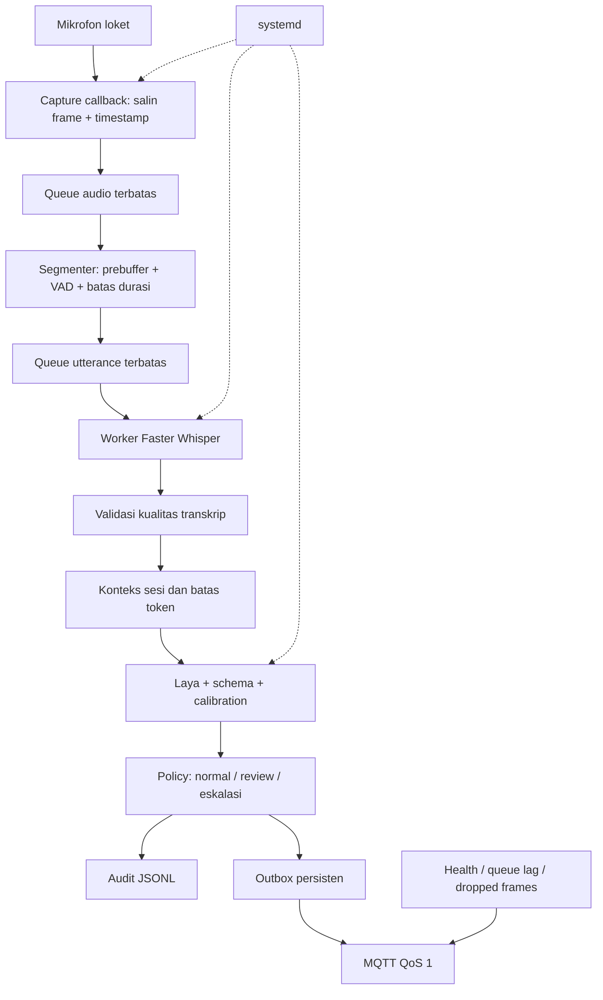

# Laya AI — rencana eksekusi deteksi risiko fraud dari percakapan resepsionis RS

Tanggal audit: 18 November 2026 (Asia/Jakarta). Target: daemon Ubuntu headless, mikrofon loket → transkripsi Indonesia → Laya → audit dan MQTT. Referensi: `../legacy/`. Dokumen ini membedakan implementasi yang sudah diuji dari pekerjaan yang masih direncanakan.

## Status setelah eksekusi lokal

P0 selesai dan P1 telah dijalankan: tiga seed × delapan epoch, kalibrasi terpisah, seleksi validation, final test, dan smoke inference. Seed 2 dikemas di `model/laya-fraud-rs-best/`. Pada final test: context accuracy 83,75%, macro-F1 79,73%, recall fraud 73,33% pada ambang diagnostik 0,5. **Gate operasional belum lulus; seluruh keputusan policy saat ini PERLU_DICEK.** Jangan menafsirkan nama direktori “best” sebagai kelayakan produksi.

Status runtime diperbarui 19 November 2026: komponen P3–P7 sudah diimplementasikan, dan jalur WAV → Faster-Whisper Large-v3 → Laya → audit → MQTT broker lokal telah lulus uji dengan GPU asli. P8 memiliki template/installer systemd tervalidasi; pemasangan OS, mikrofon target, broker target dan soak test masih perlu diverifikasi di lingkungan deployment. P2/P9 tetap menjadi pekerjaan data/pilot, dan tidak menghambat penyelesaian pipeline sesuai arahan pengguna.

Dokumen `../laya_ai_fraud_detection_planning.md` sudah dibandingkan. Ide action recommendation dan telemetry device/GPU digabung ke implementasi. Detail perbandingan, bukti, dan batas pengujian: [IMPLEMENTATION_REVIEW.md](IMPLEMENTATION_REVIEW.md). Panduan menjalankan: [README.md](README.md). Dashboard pengujian lokal kini tersedia melalui `python3 backend/app/main.py --dashboard` dari root proyek; API loopback mengontrol child pipeline yang sama dan menampilkan event serta unduhan CSV. Kualitas model historis tetap tercatat di [laporan training](training/evaluation/RESULTS.md).

## 1. Tujuan dan batas keputusan

Laya mempelajari **indikasi dalam percakapan**, bukan membuktikan seseorang melakukan fraud. Keluaran digunakan supervisor untuk verifikasi; sistem tidak menolak layanan pasien atau memutuskan sanksi. Ruang lingkup awal adalah interaksi loket; penipuan telepon masuk kepada resepsionis dapat menjadi perluasan, bukan asumsi untuk semua audio.

“Memahami konteks” harus dibuktikan melalui perilaku berikut:

| Percakapan | Target konteks | Tindakan sistem |
|---|---|---|
| “Transfer biaya ke rekening pribadi saya, tidak perlu ke kasir.” | risiko_aktif | Tandai untuk verifikasi/escalation sesuai skor |
| “Jangan transfer ke rekening pribadi; bayar di kasir.” | layanan_normal | Tidak ada indikasi pada ucapan ini |
| “Kemarin saya diminta transfer ke rekening pribadi, saya ingin mengadu.” | laporan_kejadian | Teruskan sebagai pengaduan; jangan menuduh pelapor |
| “Pembayarannya nanti lewat sana.” | konteks_kurang | Minta klarifikasi; tidak dianggap aman |
| “Isi OTP sendiri di aplikasi resmi, jangan berikan ke petugas.” | layanan_normal | Bedakan input mandiri dari pengungkapan rahasia |
| “Bacakan OTP bank kepada saya.” | risiko_aktif | Risiko pengambilan kredensial |
| “Refund resmi ke rekening pasien, tanpa PIN.” | layanan_normal | Nomor rekening sendiri bukan bukti fraud |
| “Pasien gawat darurat didahulukan menurut triase.” | layanan_normal | Urgensi klinis bukan pungli |

Kebijakan tarif, BPJS, refund, antrean prioritas, dan alur obat harus divalidasi terhadap SOP rumah sakit. Data sintetis menggunakan skenario eksplisit; jangan menyimpulkan semua permintaan NIK/alamat, apotek luar, biaya tambahan, atau kata “cepat” adalah fraud. Identitas pembicara dari satu mikrofon tidak boleh diasumsikan otomatis resepsionis.

## 2. Hasil audit proyek sebelum perubahan (snapshot historis)

Tabel berikut adalah kondisi pada audit awal, bukan status implementasi terbaru. Lihat IMPLEMENTATION_REVIEW.md untuk status setiap komponen setelah implementasi runtime. Seluruh 18 file Python pada `backend/` semula berukuran nol. Direktori model, scripts, systemd, log dan training sudah disiapkan tetapi belum berisi implementasi. Jadi diagram dan contoh payload pada rencana awal belum merupakan sistem berjalan.

| Direktori/file | Temuan dan tanggung jawab final |
|---|---|
| `backend/__init__.py`, `backend/app/__init__.py` | Penanda paket; boleh tetap kosong |
| `backend/app/main.py` | Semula kosong. Akan menangani CLI, startup, SIGTERM/SIGINT, exit code |
| `backend/app/ai_manager.py` | Semula kosong. Akan mengelola worker, antrean, konteks, health, shutdown |
| `backend/internal/__init__.py` | Penanda paket |
| `backend/internal/ai_runtime/__init__.py` | Penanda paket |
| `backend/internal/ai_runtime/ai_fraud_detection.py` | Kini berisi kebijakan keputusan pilot dan penanganan ketidakpastian |
| `backend/internal/ai_runtime/background_process/__init__.py` | Penanda paket |
| `backend/internal/ai_runtime/background_process/laya_ai_process.py` | Kini adapter inference teks lokal, memuat schema, kalibrasi dan policy checkpoint |
| `backend/internal/ai_runtime/background_process/speech_to_text.py` | Masih kosong; akan memisahkan segmentasi audio dan Whisper |
| `backend/internal/client/__init__.py`, `mqtt_client.py` | Paket dan klien MQTT yang masih perlu diimplementasikan |
| `backend/internal/utils/__init__.py`, `audio.py`, `config_loader.py`, `logger.py` | Paket dan utilitas runtime yang masih perlu diimplementasikan |
| `backend/internal/delivery/__init__.py`, `rest_handler.py` | Pada audit awal placeholder; kini HTTP/API dashboard lokal opsional. Daemon tanpa dashboard tetap berjalan langsung |
| `config/config.yaml` | MQTT, model, threshold dan logging sudah ada. Semula bernilai `production`; kini `shadow` dan menunjuk policy/kalibrasi dalam model bundle, menggantikan threshold tebakan |
| `config/microphone.json` | 16 kHz mono, index 9, blok 100 ms, hening 600 ms, prebuffer 400 ms, maksimum 15 s; perlu validasi perangkat |
| `model/` | Destinasi paket model terpilih. Status kelayakan disimpan dalam manifest/policy |
| `log/` | Audit harian runtime; bukan tempat menyimpan dataset latih tanpa review |
| `systemd/`, `scripts/` | Template service, launcher, pemeriksaan kesehatan dan installer masih perlu dibuat |
| `training/datasets/` | Kini dataset v3 dan manifest hash |
| `training/scripts/` | Kini generator deterministik dan runner fine-tuning per seed |
| `training/checkpoints/` | Checkpoint eksperimen terpisah per seed; jangan ditimpa |
| `training/evaluation/` | Evaluator, log run dan hasil evaluasi; kegagalan tetap dicatat |
| `training/tests/` | Uji pemisahan data, label, reproduksibilitas, dan kebijakan keputusan |

### Referensi legacy yang digunakan

| File/kelompok | Yang dapat dipakai dan masalah yang ditemukan |
|---|---|
| `speech_to_text_microphone.py` | Dasar sounddevice, RMS, prebuffer, endpointing, Whisper/VAD. Transkripsi sinkron menghentikan konsumsi queue; queue tidak dibatasi sehingga backlog dapat terus bertambah |
| `convert_speech_to_text.py` | Contoh transkripsi WAV. Sample rate dibaca tetapi tidak di-resample untuk array input; normalisasi `/32768` mengasumsikan PCM16 |
| `test_record.py` | Smoke test rekam 15 detik. Index perangkat hardcoded; bukan uji otomatis kualitas audio |
| `test_fraud_laya.py` | Demonstrasi noul/choice/score; belum membuktikan semua output dilatih atau terkalibrasi |
| `laya_fraud_rs.py` | CLI inferensi, audit, metrik dan threshold. Skenario banyak berupa penelepon ke RS; sinyal data medis/NIK terlalu luas bagi loket. `max(signals)` tidak otomatis menjadi probabilitas fraud. Kalibrasi dan penilaian pada data yang sama terlalu optimistis |
| `plan_prompt.md` | Ide lama memakai websocket/frontend; target terbaru memakai MQTT/headless sehingga MQTT menjadi kontrak utama |
| `train.jsonl` | 10 contoh (7 positif, 3 negatif). Beberapa label menganggap informasi ambigu sebagai fraud; tidak disalin mentah |
| `laya-train-tuning/gen_fraud_dataset.py` | v1: 408 train, 120 heldout; pemisahan template merupakan fondasi baik |
| `laya-train-tuning-v2/gen_fraud_dataset_v2.py` | v2: minimal pairs, dua giliran, 638 train, 204 heldout, 30 stress. Dipakai sebagai sumber template yang dikurasi |
| `train_v2.jsonl`, `heldout_v2.jsonl`, `stress_test.jsonl`, `meta_v2.csv` pada dua folder legacy | Salinan data/reference; jangan digabung lalu dihitung sebagai contoh independen |
| `train_synth.jsonl`, `heldout_synth.jsonl`, `meta_synth.csv` | Artefak dataset v1, bukan bukti generalisasi dunia nyata |
| `find_threshold.py` | Metrik berguna, tetapi precision untuk nol prediksi positif = 1 dapat memilih ambang kosong. Evaluator baru tidak memakai konvensi itu |
| `show_erros.py`, dua `show_errors_v2.py`, `probe.py` | Berguna untuk inspeksi FP/FN dan kasus sulit; path/pertanyaan perlu dibuat konsisten |
| `finetune.md` | Referensi format Laya; API juga diperiksa pada paket yang benar-benar terpasang |
| `laya-fraud-rs-v1`, `laya-fraud-rs-v2-s0/s1/s2` dan `checkpoint_latest/` | Bobot, tokenizer, encoder config, questions, laporan training. Semua schema pertanyaan lama hanya melatih `is_fraud`, bukan lima sinyal/kategori |
| `test_output_new.wav`, `output_c270_new.wav` | Artefak audio untuk replay nanti; belum ada ground truth transkrip/label yang terverifikasi |

Laporan lama (bukan hasil pengukuran ulang): v1 accuracy 0,9500 pada 120 heldout; v2 seed 0/1/2 masing-masing 0,8775 / 0,8971 / 0,9020 pada 204 heldout. Mean confidence v2 sekitar 0,999–1,000; semua laporan v2 menyatakan temperature tidak berubah dan confidence belum terkalibrasi. Karena dataset berbeda, v1 95% tidak membuktikan lebih unggul dari v2. Metadata training warisan dalam config bukan durasi eksperimen terbaru; gunakan `training.laya_train` dan laporan run.

Lingkungan yang diperiksa: Python virtualenv `../.env_laya`, Laya 0.4.35, torch 2.15.0, transformers 5.23.0, paho-mqtt 2.2.0, PyYAML 6.0.3; RTX 5070 sekitar 12 GB. `faster-whisper` dan `sounddevice` belum terpasang pada virtualenv ini. Driver menampilkan CUDA 13.0, tetapi kompatibilitas CTranslate2/cuDNN tetap harus diuji tersendiri.

## 3. Kontrak pembelajaran v3

### Input dan output

Bank template sumber tersimpan di `training/datasets/source_template_bank.json` beserta hash asal legacy, sehingga generator tidak membutuhkan import program di luar proyek. Sumber kebenaran: `training/datasets/v3/questions.json`. Inference harus menggunakan file yang disalin bersama checkpoint, bukan menulis ulang instruksi pertanyaan.

- `state`: teks Indonesia atau beberapa giliran dengan role yang benar-benar diketahui. Runtime satu mikrofon menggunakan label `unknown` bila identitas belum diketahui.
- `is_fraud` (noul): ada/tidak ada permintaan fraud **aktif dan eksplisit**. Pada laporan kejadian nilainya false, tetapi laporan tetap wajib masuk jalur review. Kasus konteks kurang tidak diberi target biner.
- `context_status` (choice): `risiko_aktif`, `layanan_normal`, `laporan_kejadian`, `konteks_kurang`.
- `metadata`: family ID, kategori sumber, status sintetis dan jenis variasi. Metadata bukan input model.

Dua output ini adalah baseline yang benar-benar dilatih pada tahap sekarang. `primary_category`, `severity`, dan lima sinyal dalam rencana awal **belum menjadi kemampuan v3**. Jangan mengeluarkan skor fiktif untuk kolom tersebut. Tahap perluasan akan menambahkan label kategori eksplisit: pembayaran pribadi, pungli antrean, kredensial autentikasi, biaya di luar bukti, pengalihan penjualan obat, pemalsuan klaim/dokumen, serta pengungkapan data tanpa kewenangan. Satu kasus bisa memuat beberapa kategori; gunakan multilabel bila dibutuhkan, bukan memaksa kategori tunggal.

### Data dan kebijakan anotasi

| Split | Jumlah | Keluarga | Kegunaan |
|---|---:|---:|---|
| train | 1.200 | 63 | Optimasi bobot |
| calibration | 240 | 18 | Temperature scaling setelah training |
| validation | 400 | 29 | Pemilihan seed dan threshold |
| test | 80 | 80 | Uji tantangan final setelah seed dibekukan |

Distribusi train: 420 risiko, 420 normal, 180 laporan, 180 konteks kurang. Data kalibrasi/validasi memakai proporsi serupa. Test: 30 risiko, 30 normal, 10 laporan, 10 konteks kurang; 30 berasal dari stress legacy dan 50 skenario baru. Manifest menyimpan hash setiap split. Jumlah variasi bukan jumlah konteks independen; 1.200 baris tetap hanya 63 keluarga.

Aturan penting:
1. Split keluarga dilakukan sebelum pengisian slot dan variasi. Pasangan minimal serta keluarga dua giliran tetap satu split.
2. Buang contoh legacy yang menganggap permintaan alamat/rekening saja atau SMS tak jelas sebagai fraud pasti.
3. Larangan, negasi, kutipan laporan, transfer resmi, refund resmi, triase, dan pemalsuan klaim tercakup.
4. Variasi huruf kecil/filler hanya simulasi teks sederhana, **bukan validasi noise ASR**. Jangan menghapus negasi tanpa anotasi ulang.
5. Tidak ada data pasien nyata atau identitas pribadi yang diperlukan untuk pilot ini.
6. Semua label masih hasil rancangan engineering. Review supervisor RS dan anotator kedua diperlukan sebelum dataset dianggap mewakili SOP.
7. Keluarga template terpisah mengurangi kebocoran, tetapi belum menjamin paraphrase semantik independen. Audit kemiripan dan kumpulan percakapan independen adalah gate berikutnya.

### Training dan kalibrasi yang dijalankan

Base: checkpoint multilingual lokal cache Hugging Face, bukan checkpoint fraud legacy. RLCD, 8 epoch, micro-batch 8, grad-accum 2, label smoothing 0,05, state/head maksimum 256 token. Tiga seed 0/1/2 dijalankan bergiliran agar tidak berebut VRAM. Encoder tidak dibekukan.

1. Jalankan generator dan uji invariant.
2. Dry-run tokenizer: 1.200 rows → 2.220 item valid, tidak ada item dilewati. Kasus ambigu hanya menghasilkan satu item choice.
3. Runner mematikan split kalibrasi acak bawaan (`calib_frac=0`, `calib_max=0`); bobot dilatih pada 2.220 item, 1.112 optimizer update terjadwal per seed. Dry-run CLI default dapat mencetak 1.000 update karena menyisihkan kalibrasi 10%; itu bukan konfigurasi runner.
4. Setelah training, fit temperature dari **file calibration terpisah** melalui API Laya; simpan `calibration.json` dan laporan. Warning “tanpa kalibrasi” dalam train report sebelum langkah ini tidak disembunyikan.
5. Nilai validation setelah kalibrasi. Pilih seed berdasarkan context macro-F1, lalu binary F1 sebagai pemecah seri. Jangan memilih berdasarkan test.
6. Cari review threshold dengan target recall ≥0,95 sekaligus FPR ≤0,10; ambang yang membuat hampir semua layanan normal masuk review ditolak. Escalation memerlukan precision ≥0,95, recall ≥0,50, dan minimal 20 true positives pada validation. Bila tidak tercapai, threshold = null; jangan mengarang ambang yang tampak memenuhi target.
7. Nilai test sekali untuk seed terpilih. Simpan FP/FN, confusion matrix konteks, Brier, ECE, latency batch per kasus, serta contoh kegagalan.
8. Paket model tetap `shadow`/`production_ready=false`. Nilai confidence konteks 0,70 adalah default pilot yang belum dioptimalkan; kebijakan gabungan harus dievaluasi tersendiri.

Metrik acceptance pilot yang ditargetkan, bukan hasil yang diasumsikan: context macro-F1 ≥0,85, recall risiko ≥0,95, FPR normal ≤0,05, ECE biner ≤0,10. Bila gagal: simpan hasil, jangan promosi ke produksi; tambah keluarga dan hard negatives berdasarkan **validation**, buat versi baru dan holdout baru apabila test sudah dipakai untuk diagnosis. Test kecil memerlukan confidence interval dan evaluasi eksternal sebelum klaim operasional.

## 4. Arsitektur runtime final



### Capture dan STT

- Callback tidak menjalankan Whisper, inference, disk I/O atau network. Catat overflow sounddevice dan jumlah frame hilang.
- Queue audio misalnya maksimum 5 detik; bila penuh catat gap, reset segmen/konteks terkait, jangan diam-diam menganggap analisis lengkap. Queue utterance awal maksimum 8; batas dan kebijakan drop configurable.
- Pisahkan capture/segmenter dan worker Whisper agar audio tetap dikonsumsi ketika inference berlangsung.
- Sample rate native perangkat divalidasi; bila bukan 16 kHz lakukan resampling teruji. Normalisasi berdasarkan dtype; jangan normalisasi amplifikasi noise secara membabi buta.
- RMS dapat digunakan untuk endpointing awal, tetapi bukan bukti adanya speech. Gunakan VAD; kalibrasikan noise floor loket.
- Maksimum 15 detik dihitung sebagai durasi buffer/wall time, bukan hanya blok bersuara. Potongan panjang diberi continuation ID dan overlap kecil terukur.
- Filter halusinasi menggabungkan kualitas audio, `no_speech_prob`, `avg_logprob`, repetisi. Jangan menghapus semua “terima kasih”, sebab itu ucapan normal.
- Faster-Whisper menghasilkan segment generator; latency diukur sampai generator selesai dikonsumsi. `language_probability` bukan confidence transkripsi; jangan mengisi `confidence: 0.96` tanpa definisi.
- Ini near-real-time berbasis utterance, bukan streaming token. Target awal p95 dari akhir ucapan ke decision ≤2,5 detik, real-time factor <1 saat beban berkelanjutan; target harus dibenchmark pada GPU bersama kedua model.

### Konteks percakapan

Mulai dari satu utterance dan jendela maksimal tiga utterance/30 detik pada **sesi loket yang sama**, dibatasi budget token. Reset saat idle, operator menandai pasien baru, gap audio, atau restart. Tanpa mekanisme batas sesi yang cukup andal, jangan gabungkan lintas pasien. Simpan daftar evidence utterance IDs; jangan mengarang identitas pembicara. Terapkan pemotongan-aware: context overflow → review atau window strategy tervalidasi, bukan truncation diam-diam.

Pilot dataset masih didominasi kalimat tunggal dan sedikit dua giliran. Sebelum mengaktifkan windowing, tambahkan latihan multi-turn dengan rujukan “rekening itu”, koreksi, penolakan setelah tawaran, pergantian topik, dan speaker unknown. Uji kehilangan kata negasi dari ASR secara khusus.

### Policy

Urutan keputusan: kualitas buruk/overflow → review; confidence konteks rendah → review; laporan → tindak lanjut pengaduan; ambigu → klarifikasi; ketidaksepakatan dua output → review. Eskalasi hanya untuk konteks aktif dan skor melewati threshold tersedia. `TIDAK_ADA_INDIKASI` berarti tidak ada indikasi dalam bukti yang dianalisis, bukan jaminan aman. Kategori dan penjelasan bebas tidak dibuat oleh model bila belum dilatih.

## 5. Kontrak event, audit dan MQTT

Konfigurasi broker serta `base_topic` yang ada dipertahankan untuk kompatibilitas integrasi. Nama `hermina/1/hydrant` tampak diwarisi dari sistem lain; perubahan namespace harus dikoordinasikan dengan subscriber, jangan diganti sepihak. `client_id` perlu unik per loket agar tidak saling memutus koneksi. Kredensial jangan disalin ke dokumentasi/log; loader final mendukung environment atau EnvironmentFile dengan hak akses terbatas.

Semua event memakai `schema_version`, `event_id` UUID, `timestamp` ISO8601 Asia/Jakarta, `counter_id`, `session_id`, `utterance_id`, `model_version` bila relevan. Consumer melakukan deduplikasi `event_id` karena QoS 1 dapat mengirim ulang.

| Suffix topic | Retain | Isi |
|---|---|---|
| `/status` | true | online/offline/degraded, LWT offline, versi service |
| `/transcription` | false | Teks yang sudah direduksi data sensitif, durasi, indikator kualitas ASR |
| `/fraud_alert` | false | Context, level, skor, reason, evidence IDs, versi policy/model, mode shadow |
| `/telemetry` | false | Uptime, queue depth/age, drop count, ASR/Laya latency, MQTT outbox, device/GPU health |

`action_recommendation` dihasilkan deterministik dari level/konteks, termasuk jalur pengaduan dan klarifikasi. Telemetry menyertakan GPU temperature, memory, utilization bila `nvidia-smi` tersedia, serta identitas perangkat, RMS dan usia antrean.

`fraud_score` = skor noul terkalibrasi untuk risiko aktif; bukan probabilitas kebenaran laporan atau vonis fraud. `context_confidence` memakai `answer_confidence` dari Laya; jangan tertukar dengan entropy confidence pada choice. Latency dipisahkan menjadi endpointing, queue, ASR, Laya, dan publish/ACK; contoh angka pada dokumen lama bukan benchmark.

MQTT: backoff reconnect dengan jitter, bounded disk outbox, acknowledgment tracking, event ordering per sesi, TTL transkripsi, prioritas alert, disk quota dan telemetry backlog. `publish()` yang berhasil memasukkan queue tidak berarti broker sudah menerima; simpan status sampai ACK. Hindari blocking publish pada callback audio. Broker offline tidak boleh menghentikan capture dan audit lokal.

Audit: `log/YYYY-MM-DD/transcripts_YYYYMMDD.jsonl`, `fraud_incidents_YYYYMMDD.jsonl`, dan log operasional tanpa transkrip mentah. Gunakan rotasi timezone Asia/Jakarta, permission terbatas, penanganan disk full, serta retention 30 hari configurable. OTP/PIN, identitas, dan informasi medis perlu redaksi sebelum log/MQTT; simpan raw hanya untuk pengumpulan data yang memang disetujui. Jangan otomatis memasukkan log pasien ke training; melalui anotasi dan kurasi terlebih dahulu. Audio mentah tidak disimpan secara default.

## 6. Roadmap dan status eksekusi

| Tahap | Implementasi | Bukti selesai/gate |
|---|---|---|
| P0 — audit dan kontrak | Inventaris legacy, definisi label, schema v3, scope headless | Dokumen ini, manifest dan uji dataset |
| P1 — pilot model (dijalankan sekarang) | Dataset, 3 seed, kalibrasi independen, pemilihan validation, test, adapter teks | Bobot + laporan + policy + reproduksi; status shadow |
| P2 — data domain | Review SOP oleh RS, audit paraphrase, perluasan kategori/sinyal, multi-turn/speaker unknown | Label lengkap yang direview, confusion/error per kategori, schema baru terversi |
| P3 — runtime dasar (diimplementasikan) | Requirements/lock, config validation, logger, audio utilities | Startup fail-fast untuk config/path/device salah; redaksi dan retensi diuji |
| P4 — audio/STT (replay GPU lulus; hardware target tertunda) | Capture terpisah, bounded queues, VAD, resampling, replay WAV, quality filtering | Uji hening, ketukan, kalimat panjang, cabut mikrofon, overload, sample rate; WER/CER dan error kata kritis |
| P5 — integrasi Laya (diimplementasikan) | Queue teks, batas konteks/sesi, inference dan policy | Replay audio→decision memakai model/schema/calibration sama; output invalid tidak menjadi “aman” |
| P6 — MQTT dan audit (broker lokal lulus) | Outbox, reconnect, LWT, ACK, dedup, payload versioning | Broker lokal: disconnect/restart/duplicate/recovery; verifikasi subscriber |
| P7 — orchestration (diimplementasikan dan diuji) | main/manager, health, startup order, drain shutdown | SIGTERM selesai dalam timeout, worker crash terdeteksi, startup model sekali |
| P8 — systemd staging (template lulus; instalasi/soak tertunda) | Template service, launcher, installer idempotent, rollback | Boot, restart, log rotation, GPU/audio permissions, 8 jam soak tanpa pertumbuhan queue/memory |
| P9 — shadow pilot RS | Audio representatif, ground truth manual, tanpa aksi otomatis | Metrik nyata dan acceptance disepakati; review operator, kemudian promosi versi |

Dependensi: P1 mendahului aktivasi policy; P3 mendahului P4/P6; P4+P5+P6 mendahului P7; P8 setelah replay/integration pass; produksi setelah P9. Menyalakan service tidak menggantikan uji model.

### Tanggung jawab implementasi per file

- `backend/requirements.txt` dan lock: pisahkan kebutuhan training dari inference; tambahkan faster-whisper, sounddevice, numpy, resampler, paho-mqtt, PyYAML dan pin setelah compatibility test.
- `config_loader.py`: resolve path relatif terhadap project/config root, validate thresholds/sample rates/queue bounds, load secret env, validasi kelengkapan model bundle dan hash schema.
- `logger.py`: UTC/Asia-Jakarta timestamps konsisten, structured stdout journalctl, redaksi, rotasi harian, retensi aman hanya di log root.
- `audio.py`: device selection berdasarkan nama/host API dengan index sebagai override; discovery script; channel conversion/resampling/prebuffer.
- `speech_to_text.py`: worker tanpa import-time model loading, stop event, segment metadata dan exception propagation.
- `mqtt_client.py`: client lifecycle, persistence/ack, health, reconnect, metrics, orderly shutdown.
- `ai_manager.py`: lifecycle worker/queue/context; readiness baru setelah model, device, storage siap; MQTT offline dilaporkan degraded.
- `main.py`: `--config`, `--microphone-config`, `--check-config`, `--replay`, `--dry-run-output`, SIGINT/SIGTERM.
- `systemd/hermina-fraud-detector.service`: WorkingDirectory dan interpreter absolut, EnvironmentFile, akses grup audio sesuai host, Restart=on-failure, TimeoutStopSec, journal stdout. Hindari `Nice=-5` sebelum ada kebutuhan terukur. GPU/audio access diuji sebagai user service, bukan hanya desktop shell.
- `scripts/run_standalone.sh`, `install_service.sh`, `test_mqtt_sub.py`: launcher, instalasi service idempotent, verifikasi topic/payload. Instalasi dan start broker target adalah tahap integrasi, bukan bagian training lokal.

## 7. Perintah reproduksi yang sudah tersedia

Jalankan dari root workspace `/home/ojan/laya_ai`:

```bash
.env_laya/bin/python ai_fraud_detection_microphone/training/scripts/gen_fraud_dataset_v3.py
.env_laya/bin/python -m unittest discover -s ai_fraud_detection_microphone/training/tests -v
```

Runner membutuhkan direktori base lokal lengkap (weights/tokenizer/encoder/config). Untuk run baru gunakan direktori output baru bila checkpoint seed sudah ada; runner sengaja menolak overwrite.

```bash
.env_laya/bin/python ai_fraud_detection_microphone/training/scripts/train.py --base /path/to/multilingual --seed 0
.env_laya/bin/python ai_fraud_detection_microphone/training/evaluation/evaluate.py --checkpoint ai_fraud_detection_microphone/training/checkpoints/v3-s0 --calibrate
```

Ulangi seed 1 dan 2. `training/evaluation/select_model.py` membekukan pilihan berdasarkan validation, menjalankan final test, dan membuat paket model shadow. Runner `training/scripts/train_all.sh /path/to/multilingual` mengurutkan seluruh proses untuk direktori eksperimen yang masih kosong; script menolak menimpa run yang sudah ada. `calibration.json` harus selalu dimuat pada inference; train report sebelum kalibrasi eksternal tidak digunakan sebagai ukuran confidence final.

```bash
cd ai_fraud_detection_microphone
../.env_laya/bin/python -m backend.internal.ai_runtime.background_process.laya_ai_process --checkpoint model/laya-fraud-rs-best --text "Jangan transfer ke rekening pribadi petugas, bayar di kasir resmi."
```

Entrypoint `python -m backend.app.main` sekarang menjalankan pipeline. Launcher yang direkomendasikan menangani path interpreter dan library native:

```bash
scripts/run_standalone.sh --check-config --verify-weights
scripts/run_standalone.sh --replay /path/to/rekaman.wav --dry-run-output
```

Perintah di atas dijalankan dari root proyek `ai_fraud_detection_microphone/`. Mode dry-run memakai model asli, menulis audit lokal dan mencetak event yang mengikuti konfigurasi transkrip, tanpa MQTT. Lihat README untuk mode mikrofon, broker, setup dependency, dan systemd.

## 8. Referensi teknis

- [Dokumentasi fine-tuning Laya](https://github.com/NandhaKishorM/laya/blob/main/docs/finetune.md): schema JSONL, RLCD, train/eval dan kalibrasi. Implementasi runner diverifikasi terhadap source paket lokal 0.4.35.
- [Faster-Whisper](https://github.com/SYSTRAN/faster-whisper): transkripsi, VAD dan kebutuhan runtime. [Implementasi transcribe](https://github.com/SYSTRAN/faster-whisper/blob/master/faster_whisper/transcribe.py) menyediakan metadata segment untuk filtering; metadata itu tidak otomatis merupakan confidence kebenaran kalimat.

Hasil aktual eksperimen dan keputusan pemilihan model telah dicatat pada `training/evaluation/RESULTS.md`. Dokumen tersebut menjadi acuan status, bukan target angka di rencana ini.
