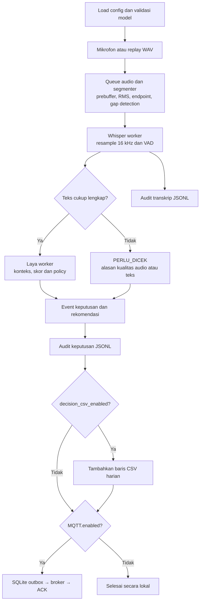

# Laya AI Voice Fraud Pipeline

Daemon Ubuntu untuk audio loket → segmentasi → Faster-Whisper → Laya → policy → audit JSONL/CSV → MQTT opsional. Setiap tahap memakai worker terpisah dan antrean terbatas. Mode replay memakai jalur yang sama. Model dimuat sekali saat startup.

## Mode lokal tanpa MQTT

Konfigurasi bawaan sekarang menjalankan **mode lokal**. Tidak perlu broker, koneksi MQTT, atau flag tambahan:

```yaml
MQTT:
  enabled: false

storage:
  log_dir: "./log"
  retention_days: 30
  decision_csv_enabled: true
  transcript_mode: "omit"
```

Jalankan dari root workspace untuk menguji rekaman yang sudah tersedia:

```bash
ai_fraud_detection_microphone/scripts/run_standalone.sh --check-config
ai_fraud_detection_microphone/scripts/run_standalone.sh --replay legacy/test_output_new.wav
```

Untuk mikrofon yang telah dikonfigurasi:

```bash
ai_fraud_detection_microphone/scripts/run_standalone.sh --duration 60
```

Output tersimpan otomatis pada root proyek:

```text
log/YYYY-MM-DD/
├── decisions_YYYYMMDD.csv          # Semua keputusan: normal, review, eskalasi
├── transcripts_YYYYMMDD.jsonl      # Transkrip + metadata kualitas ASR
├── fraud_incidents_YYYYMMDD.jsonl  # Keputusan review/eskalasi
└── events_YYYYMMDD.jsonl           # Telemetry dan keputusan normal
```

**CSV disarankan untuk inspeksi di spreadsheet; JSONL untuk detail lengkap dan analisis program.** Satu baris CSV mewakili satu keputusan, bukan bukti fraud yang sudah dikonfirmasi. Kolomnya mencakup timestamp, session/utterance/event ID, versi model/policy, transkrip, durasi audio, level, skor fraud, kelas/confidence konteks, alasan, rekomendasi, evidence IDs, dan latency tiap tahap. `evidence_utterance_ids` disimpan sebagai JSON dalam satu sel. Skor yang tidak tersedia ditulis sebagai sel kosong; misalnya ketika audio bermasalah dan model tidak dipanggil.

`transcript_mode: omit` menyembunyikan teks pada **CSV, JSONL, dan MQTT**, sementara inference tetap memakai teks asli di memori. Untuk membandingkan kalimat sintetis dengan hasil deteksi, ubah menjadi `transcript_mode: raw`; gunakan `masked` bila hanya memerlukan masking angka/kontak. Mode masked belum menghapus nama/diagnosis. Nilai teks yang dapat dianggap formula spreadsheet diberi awalan apostrof pada CSV; JSONL mempertahankan teks sesuai mode transkrip.

File dibuat per tanggal Asia/Jakarta, ditambahkan saat proses berjalan, dan melanjutkan file hari yang sama setelah restart tanpa mengulang header CSV. Retensi mengikuti `storage.retention_days`. `decision_csv_enabled: false` mematikan CSV sambil tetap menyimpan JSONL. CSV dan JSONL merupakan dua penulisan terpisah; jika proses/disk gagal di antaranya, gunakan `event_id` untuk rekonsiliasi dengan JSONL.

Untuk mengaktifkan pengiriman broker, ubah **`MQTT.enabled: true`**. CSV/JSONL tetap tersimpan pada mode MQTT; pengiriman ini adalah tambahan pada pencatatan lokal. `--no-mqtt` dapat mematikan MQTT hanya untuk satu eksekusi, sedangkan `--dry-run-output` juga mencetak event JSON ke terminal. Pada mode lokal tidak dibuat koneksi, client MQTT, atau outbox baru. Menonaktifkan MQTT tidak menghapus atau mengirim antrean outbox dari eksekusi sebelumnya.

Mode tanpa MQTT tidak otomatis berarti semua dependensi offline: model Whisper harus sudah tersedia di cache/direktori lokal. Jika belum tersedia, pemuatan pertama masih memerlukan unduhan model. `model.whisper.model_size` dapat diisi path checkpoint Whisper lokal.

## Logic flow



Capture, segmentasi, STT dan Laya berjalan di worker berbeda dengan antrean terbatas. STT mengubah audio menjadi teks; Laya menilai konteks dan policy menentukan level/rekomendasi. Audio atau teks yang tidak lengkap masuk review. Setelah pencatatan lokal, MQTT hanya dipakai jika diaktifkan. Semua event membawa ID yang menghubungkan transkrip, keputusan, dan evidence; kegagalan output lokal menyebabkan proses keluar dengan status error agar hasil tidak hilang tanpa terdeteksi.

## Struktur proyek dan fungsi

```text
ai_fraud_detection_microphone/
├── README.md                         # Setup, mode lokal/MQTT, alur, pengujian
├── PLAN_PROJECT.md                   # Arsitektur dan tahapan proyek
├── IMPLEMENTATION_REVIEW.md          # Audit implementasi dan perbandingan rencana
├── backend/
│   ├── requirements.txt              # Dependency runtime langsung
│   ├── requirements.lock.txt         # Versi dependency environment yang diuji
│   ├── app/
│   │   ├── main.py                   # CLI, override konfigurasi dan signal handler
│   │   └── ai_manager.py             # Lifecycle worker, sesi, keputusan, output
│   └── internal/
│       ├── ai_runtime/
│       │   ├── ai_fraud_detection.py  # Policy level dan ketidakpastian
│       │   └── background_process/
│       │       ├── speech_to_text.py # Adapter Whisper, VAD, kualitas dan latency
│       │       └── laya_ai_process.py # Adapter Laya, schema, kalibrasi dan token limit
│       ├── client/mqtt_client.py     # Publisher opsional, outbox SQLite, ACK/reconnect
│       ├── utils/
│       │   ├── config_loader.py      # Baca YAML/JSON, validasi, resolve path/env
│       │   ├── audio.py              # Capture/replay, PCM, resample dan segmenter
│       │   ├── logger.py             # Journal JSON, audit JSONL, CSV dan retensi
│       │   └── health.py             # Telemetry GPU dan usia antrean
│       └── delivery/                 # Placeholder REST; tidak digunakan pipeline
├── config/
│   ├── config.yaml                   # MQTT opsional, CSV, model, queue dan timeout
│   ├── microphone.json               # Perangkat dan parameter segmentasi
│   └── service.env.example           # Contoh override environment systemd
├── model/laya-fraud-rs-best/          # Weights, tokenizer, schema, kalibrasi, policy
├── scripts/
│   ├── run_standalone.sh             # Launcher manual/systemd dengan library native
│   ├── setup_runtime.sh              # Setup Python dan opsi CUDA/PortAudio lokal
│   ├── install_service.sh            # Render/install service secara idempotent
│   └── test_mqtt_sub.py               # Subscriber pemeriksa payload broker
├── systemd/hermina-fraud-detector.service
├── log/                              # Output harian lokal dan outbox saat MQTT aktif
├── tests/
│   ├── test_runtime.py               # Audio, config, audit, lifecycle dan watchdog
│   ├── test_local_outputs.py         # CSV dan mode tanpa client/koneksi MQTT
│   ├── test_mqtt_integration.py       # Integrasi broker loopback
│   ├── test_gpu_e2e.py               # Integrasi model GPU + broker, opt-in
│   ├── broker/                       # Fixture broker dan dependency terisolasi
│   └── artifacts/                    # Bukti uji lokal yang dihasilkan
└── training/
    ├── datasets/                     # Bank template, split dan manifest dataset
    ├── scripts/                      # Generator dan runner training
    ├── checkpoints/                  # Hasil per seed
    ├── evaluation/                   # Kalibrasi, evaluasi, seleksi dan RESULTS.md
    └── tests/                        # Invariant dataset dan policy
```

Folder `log/`, cache native, dan artifact pengujian sudah diabaikan oleh `.gitignore`. File `__init__.py` menandai paket Python dan tidak ditampilkan satu per satu pada struktur di atas.

## Jalankan

Dari root workspace:

```bash
ai_fraud_detection_microphone/scripts/run_standalone.sh --check-config --verify-weights
ai_fraud_detection_microphone/scripts/run_standalone.sh --list-devices
ai_fraud_detection_microphone/scripts/run_standalone.sh --check-device
ai_fraud_detection_microphone/scripts/run_standalone.sh --dry-run-output --duration 60
```

`config/microphone.json` harus menunjuk perangkat yang tersedia. Gunakan `device_name` dan `host_api` untuk pemilihan berdasarkan nama, atau `device_index` sebagai override. Pada host audit 19 November, index 9/C270 tidak tersedia; yang terdaftar hanya `pulse` dan `default`. Jangan menganggap keduanya adalah USB microphone yang dimaksud.

Uji WAV tanpa mikrofon dan tanpa broker:

```bash
ai_fraud_detection_microphone/scripts/run_standalone.sh \
  --replay legacy/test_output_new.wav --dry-run-output
```

Sample rate replay diambil dari WAV dan dikonversi ke 16 kHz untuk Whisper. Path argumen CLI relatif terhadap direktori shell; path model/log pada konfigurasi relatif terhadap root proyek. Setelah mengubah `MQTT.enabled: true`, untuk penggunaan broker yang sudah dikonfigurasi:

```bash
ai_fraud_detection_microphone/scripts/run_standalone.sh
.env_laya/bin/python ai_fraud_detection_microphone/scripts/test_mqtt_sub.py
```

`--duration` dihitung setelah capture siap. `SIGTERM`/`SIGINT` menghentikan capture kemudian menguras antrean sampai timeout. `SIGUSR1` mereset sesi sebelum utterance berikutnya dianalisis. `runtime.context_utterances` default 1; jika diperbesar, pastikan batas sesi pasien sesuai operasi loket.

## Dependensi

Environment lokal sudah memakai `.env_laya`. Python 3.12 dan PyTorch yang cocok untuk GPU diperlukan. Daftar dependency langsung: `backend/requirements.txt`; versi closure environment yang diuji: `backend/requirements.lock.txt`.

```bash
ai_fraud_detection_microphone/scripts/setup_runtime.sh
```

Faster-Whisper/CTranslate2 pada host ini memerlukan cuBLAS CUDA 12 walaupun driver mendukung CUDA 13. Library cuBLAS diinstal terpisah pada `../.cuda12` agar tidak mengganti library PyTorch. PortAudio diperlukan untuk sounddevice. Instalasi biasa Ubuntu: `sudo apt-get install libportaudio2`. Alternatif lokal yang tersedia untuk host Ubuntu x86_64:

```bash
ai_fraud_detection_microphone/scripts/setup_runtime.sh --cuda12 --local-portaudio
```

Launcher secara otomatis menambahkan direktori `.cuda12/nvidia/cublas/lib` dan `.native/usr/lib/x86_64-linux-gnu` jika tersedia. cuDNN 9 tersedia pada host pengujian; host baru perlu memverifikasi cuDNN sesuai [kebutuhan Faster-Whisper](https://github.com/SYSTRAN/faster-whisper#gpu). Library GPU dan perangkat tidak disimulasikan oleh `--check-config`.

## Konfigurasi dan event

- `config/config.yaml`: model, broker, logging, queue bounds dan timeout.
- `config/microphone.json`: perangkat, sample rate, RMS, silence timeout, prebuffer dan batas utterance.
- `config/service.env.example`: contoh override broker. Salin sebagai `service.env`, chmod 600, kemudian isi konfigurasi environment sesuai host.
- Override broker: `LAYA_MQTT_HOST`, `LAYA_MQTT_PORT`, `LAYA_MQTT_USERNAME`, `LAYA_MQTT_PASSWORD`, `LAYA_MQTT_CLIENT_ID`. Systemd memuat `service.env`; manual launcher memakai environment shell. Pengaturan `MQTT.enabled` tetap ditentukan oleh YAML atau override CLI `--no-mqtt`.

Topic mengikuti `base_topic`: `/status`, `/transcription`, `/fraud_alert`, `/telemetry`. Status memakai retain dan LWT; transkrip/alert memakai QoS 1/2 tanpa retain. Deduplikasi consumer memakai `event_id` karena pengiriman ulang mungkin terjadi. Outbox SQLite menyimpan event sampai ACK, menjaga urutan dalam sesi, memiliki TTL serta kuota jumlah/payload. Jika kuota habis, event tetap dicatat pada audit, enqueue ditolak secara eksplisit dan drop count muncul di telemetry. Tidak ada klaim pengiriman tanpa batas ketika disk/kuota penuh.

Telemetry mencakup kedalaman/usia antrean, durasi ASR/Laya, dropped frames, identitas perangkat, GPU temperature/memory/utilization jika `nvidia-smi` tersedia, dan status outbox/ACK. Tidak tersedianya telemetry GPU tidak menghentikan inference.

Keputusan menyertakan `action_recommendation` berdasarkan level/konteks. Model saat ini menghasilkan skor risiko aktif dan empat kelas konteks. Kolom kategori rinci serta lima sinyal pada rencana awal memerlukan schema dan model terlatih tambahan; tidak disintesis menjadi skor palsu.

`storage.transcript_mode`:

- `omit` (default): teks diganti `[TRANSCRIPT_OMITTED]` pada log/MQTT; inference tetap menerima teks asli di memori.
- `masked`: masking angka, email dan secret sederhana. Ini belum menganonimkan nama atau diagnosis.
- `raw`: menyimpan/mengirim transkrip lengkap, cocok untuk pengumpulan data yang memang telah disetujui.

Log harian disimpan di `log/YYYY-MM-DD/`, timezone Asia/Jakarta. Kegagalan audit/disk dan worker membuat proses keluar nonzero agar systemd dapat memulai ulang. Inference yang melewati `runtime.inference_timeout` juga memicu exit; shutdown memiliki batas drain tersendiri. Pemulihan MQTT memakai exponential backoff dan jitter. Durasi `end_to_decision` dimulai dari blok suara terakhir, termasuk endpointing; pada replay offline nilainya null karena waktu audio dipercepat.

## systemd

Template: `systemd/hermina-fraud-detector.service`. Installer menyesuaikan root, user/group, interpreter, menyimpan `.bak` bila berubah, dan tidak menyalakan capture secara default.

```bash
sudo ai_fraud_detection_microphone/scripts/install_service.sh --user ojan
sudo systemctl enable --now hermina-fraud-detector.service
journalctl -u hermina-fraud-detector.service -f -o cat
```

Verifikasi rendering tanpa instalasi:

```bash
ai_fraud_detection_microphone/scripts/install_service.sh --dest /tmp/laya-service
systemd-analyze verify /tmp/laya-service/hermina-fraud-detector.service
```

Service menjalankan launcher yang sama agar library GPU/audio dan interpreter konsisten. Akses perangkat harus diuji sebagai user service. Default systemd timeout 40 detik; jika menaikkan timeout pipeline/MQTT, sesuaikan timeout systemd. Menyalin backup service lalu `daemon-reload` dan restart memulihkan versi sebelumnya.

## Pengujian

```bash
.env_laya/bin/python -m unittest discover -s ai_fraud_detection_microphone/tests -v
.env_laya/bin/python -m unittest discover -s ai_fraud_detection_microphone/training/tests -v
```

Broker fixture hanya mendengarkan loopback. Dependency broker dipisahkan karena pin CLI-nya berbeda dari environment model:

```bash
python3 -m venv .env_laya_broker
.env_laya_broker/bin/pip install -r ai_fraud_detection_microphone/tests/broker/requirements.txt
LAYA_RUN_GPU_TESTS=1 .env_laya/bin/python -m unittest discover \
  -s ai_fraud_detection_microphone/tests -p test_gpu_e2e.py -v
```

Hasil uji runtime dan perbandingan rencana: [IMPLEMENTATION_REVIEW.md](IMPLEMENTATION_REVIEW.md). Acuan arsitektur dan roadmap: [PLAN_PROJECT.md](PLAN_PROJECT.md).
