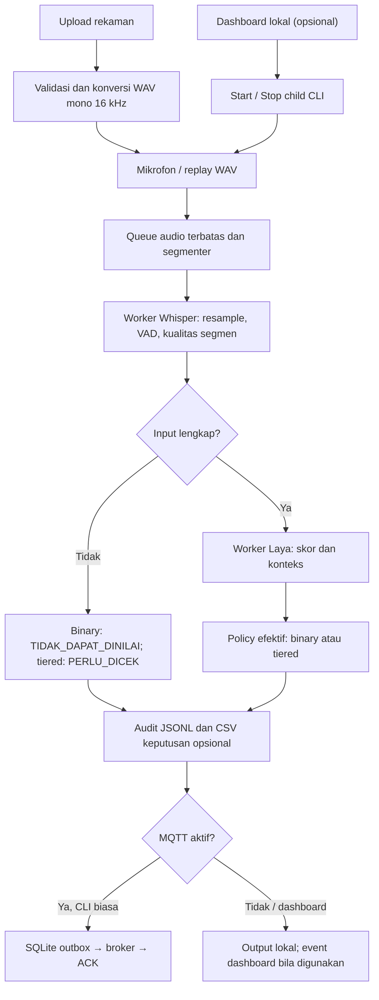
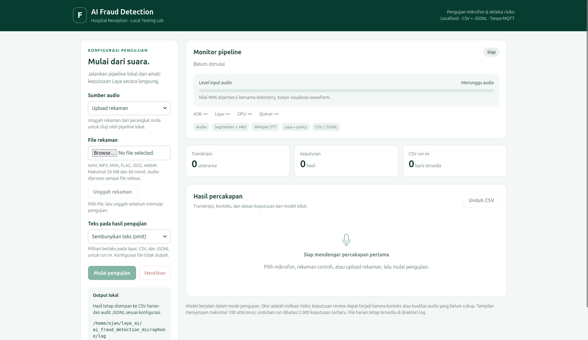
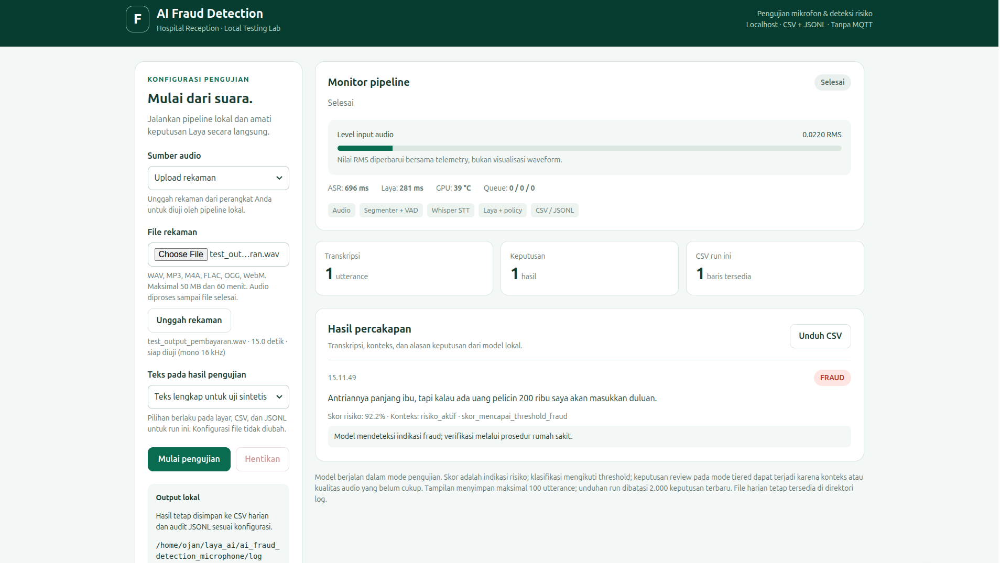
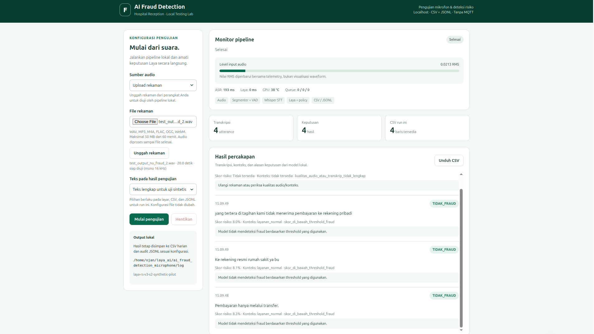

# AI Fraud Detection — Laya AI Voice Pipeline

Sistem lokal untuk mengubah percakapan resepsionis rumah sakit menjadi transkrip, menilai skor fraud dengan Laya, lalu menyimpan keputusan ke CSV/JSONL. Input dapat berasal dari mikrofon komputer server, replay WAV, atau rekaman yang diunggah melalui dashboard. MQTT bersifat opsional.

Dokumentasi ini diselaraskan dengan kode dan konfigurasi pada **19 November 2026**. Semua perintah berikut dijalankan dari root workspace `/home/ojan/laya_ai`, kecuali jika disebutkan berbeda.

## Kondisi proyek saat ini

| Bagian | Konfigurasi/perilaku saat ini |
|---|---|
| Keputusan | `decision_mode: binary` — `FRAUD` atau `TIDAK_FRAUD` untuk input valid |
| Threshold fraud | **`threshold_fraud: 0.65` (65%)**, sesuai nilai numerik di `config/config.yaml` |
| Model | Faster-Whisper `large-v3`, CUDA `float16`; Laya dari `model/laya-fraud-rs-best/` |
| Output | CSV keputusan dan audit JSONL lokal; retensi 30 hari |
| Teks tersimpan | `transcript_mode: omit`; teks disembunyikan kecuali diubah melalui konfigurasi atau pilihan dashboard |
| MQTT | `enabled: false`; dashboard juga selalu mematikan MQTT untuk run pengujian |
| Dashboard | HTTP loopback `127.0.0.1:8765`, dengan start/stop, pilihan perangkat, upload, hasil, dan unduhan CSV |
| Mikrofon | Index `9`, 16 kHz mono dalam `config/microphone.json`; ketersediaannya harus diperiksa pada host |
| Status model | Pilot sintetis, mode `shadow`, `production_ready: false`; mengganti threshold tidak melatih ulang model |

File konfigurasi adalah sumber nilai aktif. Contoh maupun log lama dapat memakai threshold/policy berbeda. Jalankan `--check-config` untuk melihat nilai efektif sebelum pengujian.

## Menjalankan program

### Dashboard lokal

```bash
python3 ai_fraud_detection_microphone/backend/app/main.py --dashboard
```

Buka **http://127.0.0.1:8765/dashboard.html**. Gunakan `--port 8766` jika port tersebut sudah dipakai. Server belum menangkap audio sampai tombol **Mulai pengujian** ditekan.

1. Pilih sumber: mikrofon komputer server atau upload rekaman.
2. Untuk mikrofon, pilih perangkat dan durasi 5–3.600 detik.
3. Pilih mode teks: `omit`, `masked`, atau `raw`.
4. Mulai pengujian, tunggu tahap pemuatan Whisper/Laya, lalu lihat transkripsi dan keputusan.
5. Hentikan bila diperlukan; gunakan **Unduh CSV** untuk hasil run aktif/terakhir.

**Mikrofon yang digunakan adalah mikrofon komputer tempat Python berjalan**, bukan mikrofon browser. Dashboard tidak mengirim audio mikrofon dari komputer browser lain ke server. File upload, sebaliknya, dikirim dari browser ke server lokal untuk dianalisis.

Pilihan dashboard berlaku untuk satu run dan tidak menulis ulang YAML/JSON. Setiap run menjalankan child pipeline sendiri; model dimuat sekali pada startup child tersebut. Dashboard selalu memakai `--dry-run-output`: MQTT mati, audit lokal tetap berjalan, dan event diteruskan ke layar. Menutup tab tidak menghentikan capture; gunakan Hentikan, tunggu durasi mikrofon berakhir, atau tutup server dengan Ctrl+C.

`dashboard.html` harus dibuka melalui HTTP, bukan `file://`. URL `/tests/testing_fraud_detection.html` menampilkan dashboard yang sama; file HTML lama yang dibuka langsung berisi petunjuk menuju dashboard.

### Upload rekaman

1. Pilih **Upload rekaman**.
2. Pilih file dan klik **Unggah rekaman**.
3. Tunggu nama file, durasi, dan status **siap diuji**.
4. Klik **Mulai pengujian**; hasil muncul pada panel percakapan dan file log.

Format umum: **WAV, MP3, M4A, FLAC, OGG, WebM**, sesuai codec yang dapat dibaca PyAV. Batasnya **50 MB** (`50 × 1024 × 1024` byte) dan **60 menit audio**. Server memeriksa isi audio lalu mengonversinya secara streaming ke WAV PCM mono 16 kHz. File rusak, tanpa track audio, upload tidak lengkap, atau durasi berlebih ditolak sebelum inference.

Rekaman upload diproses **hingga akhir file**; durasi pada dashboard hanya membatasi mikrofon. Hentikan tetap dapat menghentikan pemrosesan rekaman. Satu rekaman valid disimpan sementara untuk pengujian ulang, diganti setelah upload baru berhasil, dan dibersihkan saat server ditutup normal. Setelah server restart, unggah ulang file. Upload baru ditolak selama pipeline aktif.

### CLI mikrofon dan replay

```bash
# Memeriksa konfigurasi dan integritas bobot tanpa memuat model ke GPU
python3 ai_fraud_detection_microphone/backend/app/main.py --check-config --verify-weights

# Menemukan dan memeriksa perangkat
python3 ai_fraud_detection_microphone/backend/app/main.py --list-devices
python3 ai_fraud_detection_microphone/backend/app/main.py --check-device

# Menjalankan mikrofon sesuai konfigurasi
python3 ai_fraud_detection_microphone/backend/app/main.py

# Membatasi capture mikrofon menjadi 60 detik setelah siap
python3 ai_fraud_detection_microphone/backend/app/main.py --duration 60

# Replay WAV lokal tanpa mikrofon
python3 ai_fraud_detection_microphone/backend/app/main.py --replay /path/to/rekaman.wav
```

Input replay CLI menggunakan jalur pembaca WAV/SoundFile; gunakan upload dashboard untuk decoding format terkompresi melalui PyAV. Sample rate WAV diambil dari file dan audio dikonversi ke 16 kHz sebelum Whisper. Path rekaman dipilih sendiri; tidak ada rekaman contoh bawaan.

Entrypoint langsung meneruskan eksekusi ke `scripts/run_standalone.sh` agar import paket, interpreter, serta library CUDA/PortAudio konsisten. Launcher juga dapat dipanggil langsung dengan argumen yang sama. Default interpreter launcher adalah `../.env_laya/bin/python`; gunakan `LAYA_PYTHON=/path/to/python` untuk menggantinya.

Path argumen CLI relatif terhadap direktori shell. Path model/log pada YAML relatif terhadap root `ai_fraud_detection_microphone/`, bukan direktori tempat YAML alternatif disimpan.

## Konfigurasi

### Mode lokal dan penyimpanan

Cuplikan berikut sesuai pengaturan saat dokumentasi diperbarui:

```yaml
MQTT:
  enabled: false

model:
  laya:
    decision_mode: "binary"
    threshold_fraud: 0.65
    threshold_review: 0.50
    threshold_escalate: 0.85
    context_min_confidence: 0.70

storage:
  log_dir: "./log"
  retention_days: 30
  decision_csv_enabled: true
  transcript_mode: "omit"
```

Ini cuplikan pengaturan, bukan pengganti seluruh konfigurasi yang juga memuat path model, Whisper, dan broker. Nilai numerik YAML `0.65` berarti 65%; komentar di YAML tidak memengaruhi threshold yang dijalankan.

| `transcript_mode` | Teks pada dashboard, CSV, JSONL, dan MQTT |
|---|---|
| `omit` | Diganti `[TRANSCRIPT_OMITTED]`; inference tetap memakai teks asli di memori |
| `masked` | Masking angka, email, dan secret sederhana; bukan anonimisasi nama/diagnosis yang lengkap |
| `raw` | Teks lengkap; berguna untuk membandingkan kalimat sintetis dengan prediksi |

`decision_csv_enabled: false` hanya mematikan CSV harian; JSONL tetap dicatat dan ekspor sesi dashboard tetap tersedia. Pada mode tanpa MQTT tidak dibuat client/koneksi/outbox baru. Mematikan MQTT tidak menghapus atau mengirim antrean lama.

### Threshold biner: penilaian fraud atau tidak

Logic berada di [`ai_fraud_detection.py`](backend/internal/ai_runtime/ai_fraud_detection.py). Untuk `decision_mode: binary`, **hanya `fraud_score` dan `threshold_fraud` menentukan klasifikasi**:

| Kondisi | `level` | `is_fraud` pada event JSON |
|---|---|---|
| `fraud_score >= threshold_fraud` | `FRAUD` | `true` |
| `fraud_score < threshold_fraud` | `TIDAK_FRAUD` | `false` |

Dengan **threshold aktif 0,65**, skor 64,9% menjadi `TIDAK_FRAUD`; tepat 65% atau 85% menjadi `FRAUD`. Menaikkan threshold membuat klasifikasi FRAUD lebih sulit tercapai; menurunkannya membuat klasifikasi tersebut lebih mudah tercapai.

Kelas konteks dan confidence tetap tersedia sebagai diagnostik, tetapi tidak mengubah keputusan biner. Karena itu, `risiko_aktif` dengan skor 11,3% tetap `TIDAK_FRAUD` pada threshold 65%; `layanan_normal` dengan skor 95% tetap `FRAUD`. Threshold review/eskalasi tidak menjadi kondisi keputusan dalam mode ini.

Jika gap audio, penolakan sebagian segmen STT, atau teks kosong membuat input tidak lengkap, hasilnya **`TIDAK_DAPAT_DINILAI`**, `is_fraud: null`. Teks yang melebihi budget token juga menghasilkan status tersebut. Ini status input yang belum dapat dianalisis, bukan prediksi tidak fraud. Kegagalan model atau skor tidak valid menghentikan pipeline dengan error.

Skor harus finite dan berada di rentang 0–1. `threshold_fraud` tidak menerima `null`, boolean, atau angka di luar rentang. Pengaturan mode, threshold review/eskalasi, dan confidence juga tetap divalidasi ketika konfigurasi dimuat, walaupun tidak semuanya memengaruhi keputusan biner.

### Maksud persentase skor risiko

`fraud_score` berasal dari jawaban noul `is_fraud`: apakah percakapan memuat **permintaan atau penawaran aktif yang jelas untuk fraud di layanan resepsionis RS**? Inference memuat kalibrasi dari bundle model. Dashboard menampilkan:

```text
persentase skor = fraud_score × 100
0.113 → 11.3%
0.650 → 65.0%
```

Skor tinggi berarti dukungan model lebih besar terhadap jawaban “ada indikasi fraud aktif”. Skor bukan persentase kata mencurigakan, jumlah kerugian, akurasi model, atau bukti kesalahan petugas. Angka 85% belum membuktikan bahwa 85 dari 100 kejadian serupa benar-benar fraud; kesesuaian probabilitas perlu dinilai pada data penggunaan nyata.

`context_confidence` berbeda dari skor fraud: nilainya menunjukkan dukungan terhadap kelas konteks terpilih melalui `answer_confidence` Laya. Confidence 89% untuk `layanan_normal` bukan risiko fraud 89%. Program tidak merata-ratakan keduanya.

| `context_status` | Target interpretasi |
|---|---|
| `risiko_aktif` | Permintaan pembayaran pribadi, pungli, rahasia autentikasi, atau pemalsuan |
| `layanan_normal` | Layanan resmi, pertanyaan biasa, penolakan, atau edukasi anti-fraud |
| `laporan_kejadian` | Laporan/kutipan dugaan kejadian sebelumnya; bukan permintaan aktif oleh pelapor |
| `konteks_kurang` | Tujuan atau maksud belum cukup jelas |

Dalam mode binary kelas tersebut hanya informasi tambahan. Tidak ada keputusan berbasis keyword atau kategori rinci/lima sinyal legacy yang ditambahkan secara otomatis. Threshold manual tidak meningkatkan akurasi atau mengubah bobot model. Model tetap berstatus pilot `shadow`, dengan `production_ready: false`.

### Mode alternatif: `tiered`

Untuk kembali ke keputusan berbasis konteks, ubah `decision_mode: "tiered"`. Dengan konfigurasi saat ini, ambang mode tersebut adalah review 0,50, eskalasi 0,85, dan confidence minimum 0,70. Kondisi dievaluasi dari atas; kondisi pertama yang terpenuhi menentukan hasil:

| Urutan | Kondisi | Level dan alasan |
|---|---|---|
| 1 | Confidence konteks < minimum | `PERLU_DICEK`: `confidence_konteks_rendah` |
| 2 | Konteks `laporan_kejadian` | `PERLU_DICEK`: `tindak_lanjut_pengaduan` |
| 3 | Konteks `konteks_kurang` | `PERLU_DICEK`: `minta_klarifikasi` |
| 4 | Threshold review `null` | `PERLU_DICEK`: `ambang_belum_memenuhi_target` |
| 5 | Konteks normal dan skor ≥ review | `PERLU_DICEK`: `keluaran_model_bertentangan` |
| 6 | Konteks aktif, threshold eskalasi tersedia, skor ≥ eskalasi | `ESKALASI`: `indikasi_aktif_untuk_supervisor` |
| 7 | Konteks aktif, kondisi eskalasi tidak terpenuhi | `PERLU_DICEK`: `indikasi_aktif_perlu_verifikasi` |
| 8 | Konteks normal dan kondisi sebelumnya tidak terpenuhi | `TIDAK_ADA_INDIKASI`: `layanan_normal` |

Pada mode tiered, risiko aktif berskor rendah tetap direview. Skor tinggi saja tidak menjamin eskalasi jika konteks berbeda atau kondisi sebelumnya sudah terpenuhi. Audio tidak lengkap/token overflow masuk `PERLU_DICEK`. `PERLU_DICEK` dan `ESKALASI` adalah level tindak lanjut, bukan bukti fraud.

### Prioritas policy dan penerapan perubahan

Program membaca `decision_policy_file`, kemudian menimpa key yang tersedia di `model.laya`: `decision_mode`, `threshold_fraud`, `threshold_review`, `threshold_escalate`, dan `context_min_confidence`.

- Hapus key YAML untuk mengikuti nilai bundle, atau default fungsi jika bundle tidak memuatnya. Bundle saat ini tidak memuat mode binary/threshold fraud; tanpa key terkait, default kode adalah mode tiered dan threshold fraud 0,50 bila binary dipilih.
- `null` hanya menonaktifkan threshold review/eskalasi. Untuk memaksa review pada mode tiered, set keduanya ke null. Confidence konteks dan threshold fraud harus numerik.
- Jika eskalasi tersedia, review juga harus tersedia dan `0 <= review <= escalate <= 1`.
- Bobot, kalibrasi, dan policy bundle tidak ditulis ulang. `policy_version` dihitung dari policy efektif, sehingga perubahan konfigurasi dapat ditelusuri pada event/CSV.

Setelah mengubah konfigurasi, restart daemon/CLI. Pada dashboard, hentikan run lalu mulai run baru; child membaca konfigurasi lagi. Tidak ada perubahan threshold di tengah run. Gunakan `--check-config` untuk memeriksa mode dan `effective_thresholds`.

CLI teks juga mendukung YAML. Jalankan **dari root proyek** `ai_fraud_detection_microphone/`:

```bash
../.env_laya/bin/python -m backend.internal.ai_runtime.background_process.laya_ai_process \
  --config config/config.yaml --text "Jangan transfer ke rekening pribadi petugas, bayar di kasir resmi."
```

Mode `--checkpoint model/laya-fraud-rs-best` memakai policy bundle tanpa override YAML. Policy bundle asli masih menyimpan review/eskalasi null; hasilnya dapat berbeda dari daemon/dashboard yang memakai konfigurasi binary 65%.

## Output CSV dan JSONL

Lokasi saat ini: `ai_fraud_detection_microphone/log/YYYY-MM-DD/`, dengan timezone **Asia/Jakarta**.

| File | Isi |
|---|---|
| `decisions_YYYYMMDD.csv` | Semua keputusan: FRAUD, TIDAK_FRAUD, status tidak dapat dinilai, maupun level tiered |
| `transcripts_YYYYMMDD.jsonl` | Event transkripsi, durasi/ID audio, dan metadata kualitas ASR |
| `fraud_incidents_YYYYMMDD.jsonl` | Keputusan selain TIDAK_FRAUD/TIDAK_ADA_INDIKASI; mencakup status tidak dapat dinilai/review, bukan hanya fraud terkonfirmasi |
| `events_YYYYMMDD.jsonl` | Telemetry dan keputusan negatif/normal |

**CSV untuk inspeksi spreadsheet; JSONL untuk detail event lengkap.** CSV memuat ID event/sesi/utterance, timestamp, versi model/policy, transkrip, durasi, audio gap, `level`, `fraud_score`, konteks/confidence, alasan, rekomendasi, evidence IDs dan latency. `evidence_utterance_ids` berupa JSON dalam satu sel.

Field binary `is_fraud`, `decision_mode`, dan `threshold_fraud` tersedia pada event keputusan JSONL/API, tetapi **belum menjadi kolom tersendiri pada CSV**. Klasifikasi CSV dibaca dari `level`. Skor tak tersedia ditulis sebagai sel kosong, bukan 0%. Field `asr_ms`, `laya_ms`, `queue_ms`, `laya_queue_ms`, `endpointing_ms` dan `end_to_decision_ms` merangkum latency; `end_to_decision_ms` pada replay offline kosong karena waktu audio dipercepat.

Contoh event keputusan berikut bersifat ilustrasi:

```json
{
  "kind": "decision",
  "level": "FRAUD",
  "is_fraud": true,
  "decision_mode": "binary",
  "fraud_score": 0.82,
  "threshold_fraud": 0.65,
  "reason": "skor_mencapai_threshold_fraud",
  "mode": "shadow",
  "production_ready": false
}
```

File hari yang sama ditambahkan setelah restart tanpa mengulang header CSV. Retensi 30 hari dijalankan saat penulisan audit pertama per tanggal; file tak terkait tidak dihapus. Teks yang berpotensi dianggap formula spreadsheet diberi awalan apostrof pada CSV. CSV dan JSONL ditulis terpisah; jika proses/disk gagal di antaranya, cocokkan menggunakan `event_id`.

**Log lama tidak dihitung ulang** saat threshold/mode berubah. Satu file harian dapat memuat hasil tiered, binary 50%, dan binary 65% dari run berbeda. Gunakan `session_id`, `model_version`, `policy_version`, serta metadata keputusan JSONL untuk menelusuri hasil yang sedang dibandingkan.

## Dashboard dan API lokal

Dashboard menampilkan tahap pemuatan model, transkripsi/keputusan, rekomendasi, RMS audio, latency, GPU dan antrean. Hasil biasanya muncul setelah segmen ucapan selesai; ini bukan streaming teks per kata. RMS mengikuti interval telemetry, bukan waveform realtime.

Batas riwayat: API menahan 2.000 event terbaru, unduhan menahan 2.000 keputusan terbaru, dan layar menahan 100 utterance. Gunakan CSV/JSONL harian untuk sesi panjang. HTTP hanya bind ke loopback, memeriksa Host/origin dan token API, serta tidak mengirim kredensial broker ke browser.

| Endpoint | Fungsi |
|---|---|
| `GET /dashboard.html` | Antarmuka utama |
| `GET /api/config` | Ringkasan konfigurasi untuk UI |
| `GET /api/devices` | Daftar input audio server |
| `GET /api/status?after=...` | Status run dan event bertahap |
| `POST /api/upload` | Upload audio biner dengan batas ukuran/durasi |
| `POST /api/start`, `POST /api/stop` | Lifecycle child pipeline |
| `GET /api/export.csv` | CSV keputusan run aktif/terakhir |

Permintaan API memerlukan token sesi dari halaman dashboard; UI memasang header tersebut secara otomatis. Perubahan mode/perangkat/teks dilakukan melalui opsi run yang diizinkan, bukan path atau perintah shell dari browser.

## Logic flow



Capture, segmenter, STT dan Laya berjalan pada worker terpisah dengan antrean terbatas. Frame hilang menyebabkan reset segmen/konteks. Kegagalan worker, audit, atau inference timeout membuat proses keluar nonzero; shutdown menghentikan sumber kemudian menguras antrean sampai batas waktu.

Nilai `runtime` saat ini: queue audio 5 detik, queue utterance 8, queue teks 16, telemetry 15 detik, drain 25 detik, dan inference timeout 120 detik. Konteks default satu utterance, dengan batas konfigurasi maksimal tiga. `SIGUSR1` mereset sesi; identitas pembicara tetap `unknown`, tidak ada diarization otomatis.

## Mikrofon dan audio

`config/microphone.json` saat ini berisi index 9, sample rate 16.000 Hz, mono, blok 100 ms, ambang RMS 0,025, silence timeout 0,6 detik, minimum speech 0,5 detik, maksimum segmen 15 detik, serta prebuffer 0,4 detik. Batas maksimum segmen mencakup jeda/buffer; ucapan panjang diberi continuation ID.

Periksa perangkat pada host saat digunakan. Selain index, loader mendukung `device_name` dan `host_api`; jika nama diisi, pencarian nama/host API digunakan. CLI `--device-index` menggantinya untuk satu run. Pilihan dashboard juga berlaku untuk satu run. `--sample-rate` dapat dipakai bila perangkat memerlukan laju capture lain yang didukung.

Whisper memakai VAD dan metadata no-speech/logprob/repetisi untuk menyaring hasil. `language_probability` tidak dipakai sebagai confidence transkripsi. Jangan menyamakan confidence konteks Laya dengan kualitas ASR.

## MQTT opsional

Aktifkan `MQTT.enabled: true` dan isi host, port, client ID unik, serta kredensial yang sesuai. Nilai broker tetap berada di konfigurasi/environment dan tidak disalin ke README. Jalankan subscriber untuk memeriksa payload:

```bash
.env_laya/bin/python ai_fraud_detection_microphone/scripts/test_mqtt_sub.py
```

Topic mengikuti `base_topic`:

| Suffix | Isi |
|---|---|
| `/status` | starting/online/degraded/offline; retained, dengan LWT |
| `/transcription` | Transkripsi sesuai mode teks, ID dan metadata |
| `/fraud_alert` | FRAUD, status tidak dapat dinilai, serta review/eskalasi pada mode tiered |
| `/telemetry` | Kesehatan audio, GPU, antrean dan outbox |

Keputusan TIDAK_FRAUD/TIDAK_ADA_INDIKASI tetap masuk CSV/JSONL, tetapi tidak diterbitkan ke topic fraud_alert. MQTT menggunakan QoS 1/2, outbox SQLite persisten, reconnect/backoff, TTL, serta kuota jumlah dan payload. Event dihapus dari outbox setelah ACK. Jika kuota penuh, audit lokal tetap mencatat hasil dan enqueue ditolak dengan drop count. Consumer perlu deduplikasi `event_id` karena pengiriman ulang dimungkinkan.

Override environment tersedia untuk `LAYA_MQTT_HOST`, `LAYA_MQTT_PORT`, `LAYA_MQTT_USERNAME`, `LAYA_MQTT_PASSWORD`, dan `LAYA_MQTT_CLIENT_ID`. `--no-mqtt` mematikan MQTT untuk satu eksekusi; `--dry-run-output` sekaligus mencetak event JSON termasuk keputusan negatif.

## Dependensi dan setup

Gunakan Python 3.12, virtualenv `.env_laya`, dan PyTorch yang sesuai GPU. Dependency langsung tersedia di `backend/requirements.txt`; `requirements.lock.txt` mencatat closure versi environment yang diperiksa. Dashboard memakai HTTP server standard library dan tidak memerlukan framework web/CDN.

```bash
ai_fraud_detection_microphone/scripts/setup_runtime.sh
```

Setup script mengasumsikan interpreter virtualenv sudah tersedia. PortAudio diperlukan untuk sounddevice; pada Ubuntu dapat dipasang dengan `sudo apt-get install libportaudio2`. Alternatif library lokal untuk host Ubuntu x86_64 dan CUDA 12 cuBLAS:

```bash
ai_fraud_detection_microphone/scripts/setup_runtime.sh --cuda12 --local-portaudio
```

Launcher menambahkan `../.cuda12/nvidia/cublas/lib` dan `.native/usr/lib/x86_64-linux-gnu` jika tersedia. cuBLAS CUDA 12 dipisahkan dari library PyTorch; host yang diuji juga memiliki cuDNN 9. Periksa kecocokan runtime melalui [kebutuhan GPU Faster-Whisper](https://github.com/SYSTRAN/faster-whisper#gpu).

Model Whisper harus sudah tersedia di cache/direktori lokal untuk penggunaan tanpa unduhan. `model.whisper.model_size` dapat berisi path checkpoint lokal. `--check-config` memeriksa konfigurasi/bundle, bukan membuktikan GPU atau mikrofon siap.

## systemd

Service menjalankan pipeline mikrofon headless melalui launcher yang sama; dashboard dijalankan terpisah dengan `--dashboard`. Installer menyesuaikan root/user/group/interpreter, menyimpan backup `.bak` jika file berubah, dan tidak menyalakan capture secara default.

```bash
sudo ai_fraud_detection_microphone/scripts/install_service.sh --user ojan
sudo systemctl enable --now hermina-fraud-detector.service
journalctl -u hermina-fraud-detector.service -f -o cat
```

Untuk override environment, salin `config/service.env.example` menjadi `config/service.env` dan gunakan permission 600. Systemd memuat file tersebut; launcher manual memakai environment shell. Uji akses audio/GPU sebagai user service.

Verifikasi hasil rendering tanpa memasang ke OS:

```bash
ai_fraud_detection_microphone/scripts/install_service.sh --dest /tmp/laya-service
systemd-analyze verify /tmp/laya-service/hermina-fraud-detector.service
```

Service memakai restart on-failure dan `TimeoutStopSec=40s`. Jika menaikkan timeout drain pipeline/MQTT, sesuaikan timeout service. `SIGINT`/`SIGTERM` menghentikan capture dan menguras antrean; jangan menjalankan service dan pengujian lain pada perangkat yang sama tanpa memastikan aksesnya tersedia.

## Struktur proyek dan fungsi

```text
ai_fraud_detection_microphone/
├── README.md                         # Panduan operasional saat ini
├── PLAN_PROJECT.md                   # Arsitektur dan roadmap
├── IMPLEMENTATION_REVIEW.md          # Audit dan riwayat perubahan implementasi
├── dashboard.html                    # Dashboard lokal tanpa dependency CDN
├── docs/                             # Screenshot pengujian yang didokumentasikan
├── backend/
│   ├── requirements.txt              # Dependency runtime langsung
│   ├── requirements.lock.txt         # Snapshot versi dependency environment
│   ├── app/
│   │   ├── main.py                   # Entrypoint CLI/dashboard dan signal handler
│   │   └── ai_manager.py             # Worker, sesi, keputusan, audit dan dispatch
│   └── internal/
│       ├── ai_runtime/
│       │   ├── ai_fraud_detection.py  # Resolve/validasi policy; binary/tiered
│       │   └── background_process/
│       │       ├── speech_to_text.py # Whisper, VAD dan kualitas ASR
│       │       └── laya_ai_process.py # Laya, kalibrasi, policy dan batas token
│       ├── client/mqtt_client.py     # Outbox SQLite, publisher opsional, ACK
│       ├── delivery/rest_handler.py  # API dashboard dan lifecycle child pipeline
│       └── utils/
│           ├── config_loader.py      # YAML/JSON, path/env, policy efektif
│           ├── audio.py              # Capture/replay, PCM, resample, segmenter
│           ├── recording.py          # Validasi upload dan konversi audio
│           ├── logger.py             # Log journal, JSONL, CSV dan retensi
│           └── health.py             # GPU dan usia antrean
├── config/
│   ├── config.yaml                   # Mode, threshold, model, output dan runtime
│   ├── microphone.json               # Perangkat dan parameter audio
│   └── service.env.example           # Contoh environment untuk service
├── model/laya-fraud-rs-best/          # Weights, tokenizer, schema, policy, kalibrasi
├── scripts/
│   ├── run_standalone.sh             # Launcher manual dan systemd
│   ├── setup_runtime.sh              # Setup dependency dan library native lokal
│   ├── install_service.sh            # Render/install service idempotent
│   └── test_mqtt_sub.py               # Subscriber pemeriksa event
├── systemd/hermina-fraud-detector.service
├── log/                              # Output harian dan outbox ketika MQTT aktif
├── tests/
│   ├── test_binary_policy.py         # Batas biner dan independensi dari konteks
│   ├── test_configurable_policy.py   # Override, validasi dan versi policy
│   ├── test_runtime.py               # Audio, konfigurasi, lifecycle, watchdog
│   ├── test_local_outputs.py         # CSV/JSONL dan output tanpa MQTT
│   ├── test_dashboard.py             # HTTP/API, entrypoint, lifecycle dan ekspor
│   ├── test_recording_upload.py      # Konversi, batas dan cleanup upload
│   ├── test_mqtt_integration.py       # ACK, offline/restart/reconnect broker
│   ├── test_gpu_e2e.py               # Model GPU → broker, opt-in
│   ├── browser/                      # Playwright QA dan dependency terisolasi
│   ├── broker/                       # Fixture MQTT loopback dan dependency
│   ├── artifacts/                    # Hasil pengujian lokal yang dihasilkan
│   └── testing_fraud_detection.html   # Petunjuk/alias dashboard lama
└── training/
    ├── datasets/                     # Bank template, split dan manifest v3
    ├── scripts/                      # Generator dan runner fine-tuning
    ├── checkpoints/                  # Checkpoint tiap seed
    ├── evaluation/                   # Kalibrasi, evaluasi, seleksi, RESULTS.md
    └── tests/                        # Invariant dataset dan evaluasi/policy
```

File `__init__.py` tidak ditampilkan satu per satu. Log, artifact pengujian, virtualenv, library native, audio dan bobot besar mengikuti aturan `.gitignore`; keberadaan source tidak menjamin semua artifact model/audio tersedia setelah clone.

## Training dan laporan model

Lihat [Penjelasan model Laya dan kualitas evaluasinya](penjelasan_model.md) untuk arsitektur model, dataset, parameter training, arti metrik (accuracy, loss, precision, recall, F1, TP/TN/FP/FN), hasil evaluasi, pengaruh threshold, dan keterbatasan model.

Dataset v3 tersedia dalam split train 1.200, calibration 240, validation 400, dan test 80 contoh sintetis. Generator berada di `training/scripts/gen_fraud_dataset_v3.py`, training di `train.py`/`train_all.sh`, dan evaluasi/seleksi di `training/evaluation/`. Runner menolak menimpa direktori checkpoint yang sudah ada.

[Laporan training](training/evaluation/RESULTS.md) adalah **snapshot eksperimen sebelumnya** dengan ambang diagnostik 0,50 dan policy bundle saat itu. Laporan tersebut tidak berarti runtime sekarang selalu review dan tidak menjadi pengukuran hasil threshold 65%. Model terpilih tetap seed 2; perubahan runtime tidak menjalankan training baru. Screenshot pengujian juga bukan pengganti evaluasi akurasi pada data independen.

[PLAN_PROJECT.md](PLAN_PROJECT.md) memuat roadmap; [IMPLEMENTATION_REVIEW.md](IMPLEMENTATION_REVIEW.md) memuat audit implementasi. Ketersediaan mikrofon target, akses broker target, pemasangan service, dan soak test perlu diverifikasi pada lingkungan deployment.

## Pengujian

### Uji kalimat langsung tanpa STT

Script terpisah [tests/try_laya_text.py](tests/try_laya_text.py) memuat model dan kalibrasi yang sama dengan project. Threshold serta mode keputusan dibaca dari `config/config.yaml`, bukan angka yang ditanam dalam script. Tidak menjalankan mikrofon, Whisper, MQTT, atau menulis log percakapan project.

Dari root repository, jalankan mode interaktif (model dimuat satu kali):

```bash
python3 ai_fraud_detection_microphone/tests/try_laya_text.py
```

Masukkan kalimat lalu Enter; ketik `/exit` untuk keluar. Setiap kalimat dinilai mandiri, tanpa riwayat input sebelumnya. Untuk satu kalimat dan hasil JSON:

```bash
python3 ai_fraud_detection_microphone/tests/try_laya_text.py --text "Silakan bayar melalui kasir resmi rumah sakit." --json
```

Gunakan `--device cpu` bila ingin menjalankan pada CPU, atau `--config /path/config.yaml` untuk konfigurasi lain. Script otomatis memakai `.env_laya/bin/python` bila tersedia; `LAYA_PYTHON` dapat memilih interpreter lain. Dependensi model harus terpasang pada interpreter tersebut.

Pada mode binary, skor `>= threshold_fraud` menghasilkan `FRAUD`, selebihnya `TIDAK_FRAUD`. Input terlalu panjang dapat menghasilkan `TIDAK_DAPAT_DINILAI`. Jika konfigurasi diubah ke tiered, script juga mengikuti keputusan tiered agar tetap sama dengan project. Hasil ini adalah prediksi model pilot, bukan label kebenaran untuk menghitung accuracy.


### Unit dan integrasi runtime

```bash
.env_laya/bin/python -m unittest discover -s ai_fraud_detection_microphone/tests -v
.env_laya/bin/python -m unittest discover -s ai_fraud_detection_microphone/training/tests -v
```

Test GPU dilewati pada discovery biasa. Broker fixture hanya mendengarkan loopback, dengan dependency terpisah dari environment model:

```bash
python3 -m venv .env_laya_broker
.env_laya_broker/bin/pip install -r ai_fraud_detection_microphone/tests/broker/requirements.txt
LAYA_RUN_GPU_TESTS=1 LAYA_TEST_RECORDING=/path/to/rekaman.wav .env_laya/bin/python -m unittest discover \
  -s ai_fraud_detection_microphone/tests -p test_gpu_e2e.py -v
```

### Browser desktop/mobile dan model asli

```bash
python3 -m venv .env_laya_ui
.env_laya_ui/bin/pip install -r ai_fraud_detection_microphone/tests/browser/requirements.txt
.env_laya_ui/bin/python -m playwright install chromium
.env_laya_ui/bin/python ai_fraud_detection_microphone/tests/browser/check_dashboard.py /path/to/rekaman.wav
```

Script menyalakan server loopback pada port sementara, menguji rekaman yang dipilih pengguna, penolakan file rusak, upload dan inference GPU, reload saat run, unduhan CSV, start/stop, serta layout desktop/mobile. Server dihentikan setelah uji; screenshot/log tersimpan di `tests/artifacts/`. Pemeriksaan ini membuktikan integrasi pada environment yang diuji, bukan kualitas model atau latency realtime pada semua perangkat.

## Pemecahan masalah singkat

| Gejala | Pemeriksaan |
|---|---|
| Teks `[TRANSCRIPT_OMITTED]` | Mode teks masih omit; pilih raw untuk uji sintetis yang memerlukan teks lengkap |
| Skor 60% diberi TIDAK_FRAUD | Threshold aktif saat ini 65%; periksa `--check-config` dan metadata run |
| Masih muncul PERLU_DICEK/ESKALASI | Periksa apakah memakai mode tiered, CLI `--checkpoint`, log lama, atau run yang belum direstart |
| TIDAK_DAPAT_DINILAI | Periksa gap/kualitas audio, teks kosong/ditolak, atau batas token |
| Mikrofon gagal dibuka | Jalankan `--list-devices`/`--check-device`, periksa index/nama, sample rate, dan PortAudio |
| Upload ditolak | Periksa ukuran, durasi, track audio, format yang valid, dan apakah run masih aktif |
| Dashboard tidak terhubung | Jalankan `--dashboard`, buka URL HTTP yang dicetak, dan periksa port/terminal |
| Perubahan threshold belum terlihat | Hentikan run lalu mulai lagi; log historis tidak berubah |
| CUDA gagal meskipun config valid | Periksa library CUDA/cuDNN melalui launcher; check-config tidak menjalankan inference GPU |

## Dashboard AI Fraud Detection - Test View

### Tampilan Dashboard



### Hasil Test dengan data Fraud




### Hasil Test dengan data No Fraud



