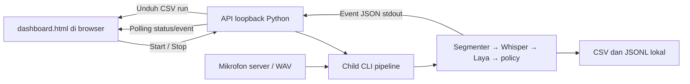
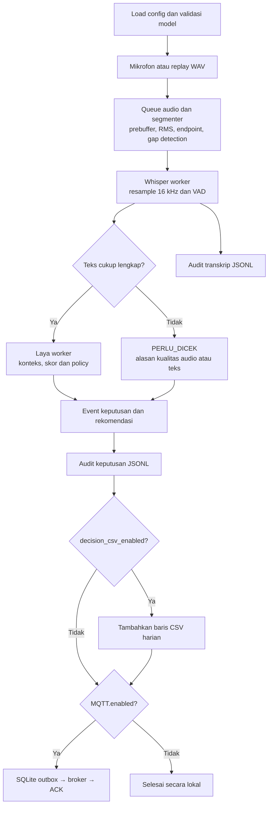
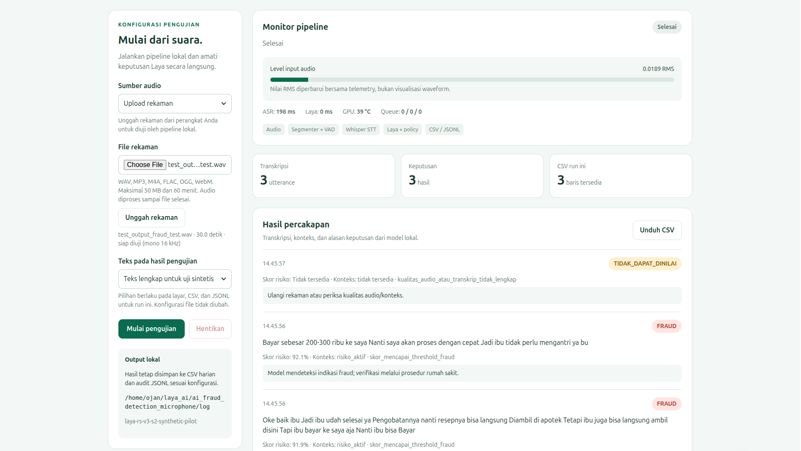
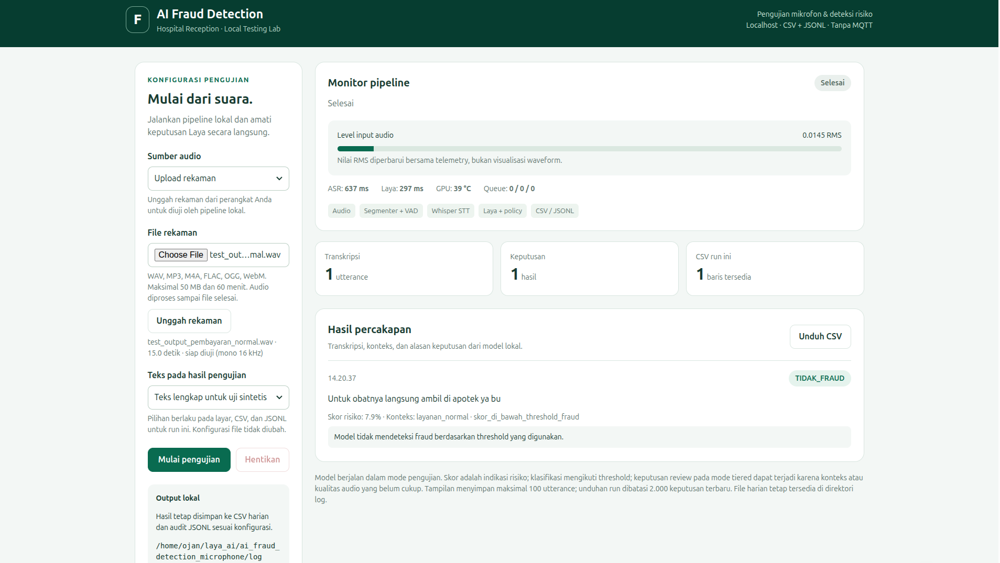

# Laya AI Voice Fraud Pipeline

Daemon Ubuntu untuk audio loket → segmentasi → Faster-Whisper → Laya → policy → audit JSONL/CSV → MQTT opsional. Setiap tahap memakai worker terpisah dan antrean terbatas. Mode replay memakai jalur yang sama. Model dimuat sekali saat startup.

## Entrypoint langsung dan dashboard lokal

Bisa menjalankan pipeline langsung dari root workspace menggunakan:

```bash
python3 ai_fraud_detection_microphone/backend/app/main.py
```

Entrypoint meneruskan eksekusi ke launcher yang sama dengan service agar package import, interpreter `.env_laya`, CUDA, dan PortAudio konsisten. Gunakan `LAYA_PYTHON=/path/to/python` jika ingin memilih interpreter lain. Mikrofon tetap mengikuti `config/microphone.json`; jalankan `--list-devices` atau `--check-device` untuk memeriksa konfigurasi.

Untuk mengoperasikan pengujian lewat dashboard:

```bash
python3 ai_fraud_detection_microphone/backend/app/main.py --dashboard
```

Buka **http://127.0.0.1:8765/dashboard.html** di browser. Port bisa diubah dengan `--port 8766`. Server tetap berjalan sampai dihentikan dengan Ctrl+C; capture baru dimulai setelah tombol **Mulai pengujian** ditekan. Pemuatan model dilakukan pada setiap run, dengan tahap Whisper/Laya ditampilkan di monitor.

Fitur dashboard:

- Pilih perangkat input mikrofon, rekaman contoh `legacy/test_output_new.wav`, atau upload rekaman sendiri.
- Pilih durasi 5–3.600 detik dan mode teks omit/masked/raw untuk run tersebut.
- Mulai/hentikan pipeline, lihat transkripsi dan keputusan beserta skor, konteks, alasan, rekomendasi, serta telemetry audio/GPU/antrean.
- Unduh CSV run aktif/terakhir. Seluruh hasil harian tetap mengikuti konfigurasi pencatatan di direktori log.

### Menguji file rekaman sendiri

1. Pilih **Upload rekaman** pada Sumber audio.
2. Pilih file, lalu klik **Unggah rekaman**. Tunggu nama file, durasi, dan status **siap diuji** tampil.
3. Pilih mode teks. Gunakan **Teks lengkap untuk uji sintetis** jika ingin melihat transkripsi.
4. Klik **Mulai pengujian**. Hasil tampil pada panel percakapan dan tersimpan ke CSV/JSONL; tombol **Unduh CSV** mengekspor keputusan run tersebut.

Format umum: WAV, MP3, M4A, FLAC, OGG, WebM (sesuai codec yang dapat dibaca PyAV). Batas upload **50 MB** dan durasi audio **60 menit**. Server memeriksa isi audio, bukan hanya ekstensi, lalu mengonversi secara streaming ke WAV PCM mono 16 kHz. File rusak, upload tidak lengkap, atau audio yang melewati batas ditolak sebelum model dijalankan.

Rekaman contoh dan upload diproses **hingga akhir file**; pengaturan durasi hanya berlaku untuk capture mikrofon. Tombol Hentikan tetap dapat menghentikan pemrosesan rekaman. Satu rekaman unggahan disimpan sementara agar bisa diuji ulang; file sementara diganti/dihapus ketika unggahan baru berhasil atau server ditutup normal. CSV/JSONL hasil analisis mengikuti retensi log. Setelah server restart, unggah ulang file. Upload baru ditolak ketika pipeline masih aktif.

Dashboard menggunakan **mikrofon komputer tempat Python dijalankan**, melalui sounddevice; tidak meminta izin mikrofon browser. Jika browser dan Python berjalan pada komputer yang berbeda, mikrofon browser tidak dikirim ke server. Jalur mikrofon tetap melewati segmenter, Whisper, Laya, policy, dan audit yang sama dengan daemon.

Dashboard selalu mematikan MQTT untuk run pengujian, melalui `--dry-run-output`, dan tetap menyimpan output lokal. Pilihan teks/perangkat/durasi tidak menulis ulang konfigurasi. `transcript_mode: omit` berarti teks juga disembunyikan di layar; pilih raw untuk kalimat sintetis jika ingin membaca hasil transkripsi. Model yang sedang dipakai dapat mengeluarkan review untuk semua ucapan tergantung threshold dan confidence konteks; dashboard menampilkan hasil sebenarnya.

`dashboard.html` adalah antarmuka utama. File lama `tests/testing_fraud_detection.html` sekarang menjadi halaman petunjuk ketika dibuka langsung; jika diakses melalui server di `/tests/testing_fraud_detection.html`, alamat itu menampilkan dashboard yang sama. HTML yang dibuka dengan `file://` tidak bisa menjalankan pipeline: gunakan URL server lokal di atas.

HTTP server hanya bind ke loopback. API tidak memakai kredensial MQTT, tidak mengembalikan password konfigurasi, dan memeriksa Host/origin serta token sesi untuk permintaan API. Menutup tab browser tidak menghentikan capture; gunakan tombol Hentikan, tunggu durasi berakhir, atau hentikan server dengan Ctrl+C. Server menghentikan child pipeline saat keluar.

Riwayat API/unduhan dibatasi 2.000 event/keputusan terbaru dan kartu layar dibatasi 100 utterance. Untuk seluruh data dari sesi panjang, gunakan file CSV/JSONL harian. Error perangkat, proses yang gagal, dan pemuatan model ditampilkan di dashboard; detail operasional juga tersedia di terminal Python.



## Mode lokal tanpa MQTT

Konfigurasi bawaan sekarang menjalankan **mode lokal**. Tidak perlu broker, koneksi MQTT, atau flag tambahan:

```yaml
MQTT:
  enabled: false

storage:
  log_dir: "./log"
  retention_days: 30
  decision_csv_enabled: true
  transcript_mode: "omit"
```

Jalankan dari root workspace untuk menguji rekaman yang sudah tersedia:

```bash
ai_fraud_detection_microphone/scripts/run_standalone.sh --check-config
ai_fraud_detection_microphone/scripts/run_standalone.sh --replay legacy/test_output_new.wav
```

Untuk mikrofon yang telah dikonfigurasi:

```bash
ai_fraud_detection_microphone/scripts/run_standalone.sh --duration 60
```

Output tersimpan otomatis pada root proyek:

```text
log/YYYY-MM-DD/
├── decisions_YYYYMMDD.csv          # Semua keputusan: normal, review, eskalasi
├── transcripts_YYYYMMDD.jsonl      # Transkrip + metadata kualitas ASR
├── fraud_incidents_YYYYMMDD.jsonl  # Keputusan review/eskalasi
└── events_YYYYMMDD.jsonl           # Telemetry dan keputusan normal
```

**CSV disarankan untuk inspeksi di spreadsheet; JSONL untuk detail lengkap dan analisis program.** Satu baris CSV mewakili satu keputusan, bukan bukti fraud yang sudah dikonfirmasi. Kolomnya mencakup timestamp, session/utterance/event ID, versi model/policy, transkrip, durasi audio, level, skor fraud, kelas/confidence konteks, alasan, rekomendasi, evidence IDs, dan latency tiap tahap. `evidence_utterance_ids` disimpan sebagai JSON dalam satu sel. Skor yang tidak tersedia ditulis sebagai sel kosong; misalnya ketika audio bermasalah dan model tidak dipanggil.

`transcript_mode: omit` menyembunyikan teks pada **CSV, JSONL, dan MQTT**, sementara inference tetap memakai teks asli di memori. Untuk membandingkan kalimat sintetis dengan hasil deteksi, ubah menjadi `transcript_mode: raw`; gunakan `masked` bila hanya memerlukan masking angka/kontak. Mode masked belum menghapus nama/diagnosis. Nilai teks yang dapat dianggap formula spreadsheet diberi awalan apostrof pada CSV; JSONL mempertahankan teks sesuai mode transkrip.

File dibuat per tanggal Asia/Jakarta, ditambahkan saat proses berjalan, dan melanjutkan file hari yang sama setelah restart tanpa mengulang header CSV. Retensi mengikuti `storage.retention_days`. `decision_csv_enabled: false` mematikan CSV sambil tetap menyimpan JSONL. CSV dan JSONL merupakan dua penulisan terpisah; jika proses/disk gagal di antaranya, gunakan `event_id` untuk rekonsiliasi dengan JSONL.

Untuk mengaktifkan pengiriman broker, ubah **`MQTT.enabled: true`**. CSV/JSONL tetap tersimpan pada mode MQTT; pengiriman ini adalah tambahan pada pencatatan lokal. `--no-mqtt` dapat mematikan MQTT hanya untuk satu eksekusi, sedangkan `--dry-run-output` juga mencetak event JSON ke terminal. Pada mode lokal tidak dibuat koneksi, client MQTT, atau outbox baru. Menonaktifkan MQTT tidak menghapus atau mengirim antrean outbox dari eksekusi sebelumnya.

Mode tanpa MQTT tidak otomatis berarti semua dependensi offline: model Whisper harus sudah tersedia di cache/direktori lokal. Jika belum tersedia, pemuatan pertama masih memerlukan unduhan model. `model.whisper.model_size` dapat diisi path checkpoint Whisper lokal.

## Logic flow



Capture, segmentasi, STT dan Laya berjalan di worker berbeda dengan antrean terbatas. STT mengubah audio menjadi teks; Laya menilai konteks dan policy menentukan level/rekomendasi. Audio atau teks yang tidak lengkap masuk status tidak dapat dinilai pada mode binary, atau review pada mode tiered. Setelah pencatatan lokal, MQTT hanya dipakai jika diaktifkan. Semua event membawa ID yang menghubungkan transkrip, keputusan, dan evidence; kegagalan output lokal menyebabkan proses keluar dengan status error agar hasil tidak hilang tanpa terdeteksi.

## Kondisi keputusan: apakah ucapan ini fraud?

Sumber logic adalah [`assess()` pada ai_fraud_detection.py](backend/internal/ai_runtime/ai_fraud_detection.py). Fungsi ini menggabungkan **skor indikasi fraud aktif**, **kelas konteks**, dan **confidence kelas konteks** dengan ambang dasar dari `model/laya-fraud-rs-best/decision_policy.json` yang dapat ditimpa melalui `model.laya` pada `config/config.yaml`. Hasilnya adalah level tindak lanjut, bukan pembuktian bahwa pembicara melakukan fraud.

### Mode biner: hanya fraud atau tidak fraud (default)

Untuk penilaian langsung, gunakan **`threshold_fraud`** pada `config/config.yaml`:

```yaml
model:
  laya:
    decision_mode: "binary"
    threshold_fraud: 0.50
```

| Perbandingan skor | Label (`level`) | `is_fraud` pada event JSON |
|---|---|---|
| `fraud_score >= threshold_fraud` | `FRAUD` | `true` |
| `fraud_score < threshold_fraud` | `TIDAK_FRAUD` | `false` |

Dengan threshold 0,50: skor 49,9% → `TIDAK_FRAUD`; tepat 50% atau 85% → `FRAUD`. Menaikkan threshold membuat label FRAUD lebih sulit tercapai; menurunkannya membuat label tersebut lebih mudah tercapai. Angka 0,50 adalah nilai manual pengujian, bukan hasil validasi produksi.

**Pada mode binary hanya skor fraud menentukan klasifikasi.** Kelas konteks dan confidence tetap ditampilkan sebagai informasi tambahan, tetapi tidak mengubah label. `threshold_review`, `threshold_escalate`, dan `context_min_confidence` tidak menjadi kondisi keputusan biner. Jadi konteks `laporan_kejadian` atau `risiko_aktif` tidak lagi otomatis memaksa review: hasil mengikuti skor. Ini menyederhanakan keputusan, bukan melatih ulang atau meningkatkan akurasi model.

Dashboard, CSV harian dan unduhan menggunakan label `FRAUD`/`TIDAK_FRAUD`. Event JSON juga memuat `is_fraud`, `decision_mode`, dan `threshold_fraud`. Keluaran positif tetap berarti **klasifikasi model**, bukan pembuktian fraud. Prediksi negatif dicatat pada log umum/CSV; prediksi positif dikirim ke topic fraud_alert jika MQTT diaktifkan.

Jika audio/transkrip tidak lengkap atau konteks melewati batas token, labelnya **`TIDAK_DAPAT_DINILAI`** dengan `is_fraud: null`, bukan `TIDAK_FRAUD`. Itu status kegagalan input, bukan kelas fraud ketiga. Kegagalan inference/score tidak valid tetap menghasilkan error pipeline, tanpa mengarang prediksi negatif.

Untuk kembali ke penilaian konteks, review dan eskalasi sebelumnya, gunakan `decision_mode: "tiered"`. Penjelasan urutan kondisi dan level review/eskalasi di bawah khusus untuk mode tersebut. Setelah mengganti mode atau threshold, restart daemon atau hentikan dan mulai run baru di dashboard.

### Mengatur threshold melalui `config.yaml`

Threshold mode bertingkat (`tiered`) dapat diubah pada `model.laya`:

```yaml
model:
  laya:
    # Path bundle, decision_policy_file dan calibration_file tetap digunakan.
    decision_mode: "tiered"
    threshold_review: 0.50
    threshold_escalate: 0.85
    context_min_confidence: 0.70
```

Nilai tersebut sekarang aktif sebagai **pengaturan manual untuk pengujian lokal**, bukan threshold yang sudah lolos validasi produksi. `0.50` berarti 50%, bukan angka `50`. Ketiganya harus berupa angka finite dalam rentang 0–1; jika eskalasi diaktifkan, threshold review harus tersedia dan `threshold_review <= threshold_escalate`.

| Pengaturan | Pengaruh ketika disesuaikan |
|---|---|
| `threshold_review` | Pada konteks `layanan_normal`, skor di atas/sama dengan ambang menyebabkan review karena konflik. Menurunkan nilai ini membuat lebih banyak prediksi normal masuk review. Kelas `risiko_aktif` tetap direview meskipun skornya di bawah ambang ini |
| `threshold_escalate` | Pada konteks `risiko_aktif` dengan confidence cukup, skor di atas/sama dengan ambang menyebabkan eskalasi. Menurunkannya membuat eskalasi lebih mudah dicapai |
| `context_min_confidence` | Confidence konteks di bawah ambang selalu masuk review sebelum kondisi lainnya. Menaikkannya memperbanyak hasil yang perlu diperiksa karena ketidakpastian konteks |

Prioritas konfigurasi: baca policy bundle, lalu timpa tiga key tersebut jika ada pada YAML. **Hapus key** untuk memakai nilai bundle; **`null` eksplisit** menonaktifkan threshold review/eskalasi. Untuk memaksa semua keluaran valid ke review, pilih `decision_mode: tiered`, lalu set **kedua threshold review/eskalasi** ke null:

```yaml
threshold_review: null
threshold_escalate: null
context_min_confidence: 0.70
```

Untuk mematikan eskalasi saja, pertahankan `threshold_review` numerik dan set `threshold_escalate: null`. Confidence konteks dan `threshold_fraud` tidak boleh null. File policy model, bobot, dan kalibrasi tidak ditulis ulang. `policy_version` pada event/CSV dihitung dari policy efektif, sehingga perubahan threshold menghasilkan versi yang dapat ditelusuri.

Setelah mengedit YAML, restart proses daemon/CLI yang sedang berjalan. Pada dashboard, hentikan run lalu mulai run baru; controller membaca ulang konfigurasi saat memulai child pipeline. Nilai tidak berubah di tengah run. Verifikasi threshold yang sedang dikonfigurasi dengan:

```bash
python3 ai_fraud_detection_microphone/backend/app/main.py --check-config
```

Output mencantumkan `effective_thresholds`. Daemon, replay, upload, dan run dashboard memakai override YAML ini. CLI teks `laya_ai_process` memakai override jika dijalankan dengan `--config config/config.yaml`; mode `--checkpoint` tetap memakai policy dari bundle yang dipilih.

### Arti kelas konteks

| `context_status` | Makna | Contoh ucapan dan interpretasi |
|---|---|---|
| `risiko_aktif` | Ada permintaan/penawaran aktif yang dinilai mencurigakan oleh model | “Transfer biaya pendaftaran ke rekening pribadi saya, tidak perlu ke kasir.” → indikasi pengalihan pembayaran yang perlu diverifikasi |
| `layanan_normal` | Layanan resmi, pertanyaan biasa, penolakan, atau edukasi anti-fraud | “Jangan transfer ke rekening pribadi petugas; bayar di kasir resmi.” → larangan melakukan transfer pribadi, bukan permintaan fraud |
| `laporan_kejadian` | Melaporkan atau mengutip dugaan kejadian sebelumnya | “Kemarin petugas meminta saya mentransfer ke rekening pribadinya, saya ingin mengadu.” → tindak lanjuti laporan; pelapor tidak dianggap sedang meminta fraud |
| `konteks_kurang` | Bukti percakapan belum cukup untuk menentukan maksud atau kanal | “Pembayarannya nanti lewat sana.” → minta klarifikasi; jangan langsung menyimpulkan aman atau fraud |

Contoh tersebut menjelaskan target interpretasi model. Output aktual dapat berbeda karena kesalahan STT atau prediksi model. Permintaan identitas untuk pendaftaran, refund resmi, dan urgensi medis perlu dinilai sesuai konteks/SOP; kemunculan kata “rekening”, “OTP”, atau “cepat” sendiri bukan keputusan fraud.

### Urutan kondisi mode `tiered` di `assess()`

**Kondisi diperiksa dari atas ke bawah; kondisi pertama yang terpenuhi menentukan hasil.** `score` adalah `fraud_score`, `confidence` adalah `context_confidence`, `review` adalah `threshold_review`, dan `escalate` adalah `threshold_escalate`.

| Urutan | Kondisi | `level` | `reason` dan maksudnya |
|---|---|---|---|
| 1 | `confidence < context_min_confidence` (default 0,70) | `PERLU_DICEK` | `confidence_konteks_rendah`: model belum cukup yakin atas kelas konteks yang dipilih |
| 2 | `context == laporan_kejadian` | `PERLU_DICEK` | `tindak_lanjut_pengaduan`: teruskan pengaduan untuk diperiksa |
| 3 | `context == konteks_kurang` | `PERLU_DICEK` | `minta_klarifikasi`: tujuan/maksud percakapan belum jelas |
| 4 | `review is None` (`null` di JSON) | `PERLU_DICEK` | `ambang_belum_memenuhi_target`: belum tersedia ambang review yang diterima dari evaluasi |
| 5 | `context == layanan_normal` dan `score >= review` | `PERLU_DICEK` | `keluaran_model_bertentangan`: kelas konteks menyebut normal, tetapi skor risiko melewati ambang review |
| 6a | `context == risiko_aktif`, `escalate` tersedia, dan `score >= escalate` | `ESKALASI` | `indikasi_aktif_untuk_supervisor`: ada indikasi aktif dan skor cukup tinggi menurut policy; minta supervisor memverifikasi |
| 6b | `context == risiko_aktif`, tetapi kondisi 6a tidak terpenuhi | `PERLU_DICEK` | `indikasi_aktif_perlu_verifikasi`: kelas konteks masih menunjukkan risiko meskipun skor belum mencapai ambang eskalasi |
| 7 | Tidak ada kondisi di atas yang terpenuhi | `TIDAK_ADA_INDIKASI` | `layanan_normal`: konteks normal, confidence mencukupi, ambang review tersedia, dan skor berada di bawah ambang review |

Batas bersifat eksplisit: confidence **tepat 0,70** tidak terkena kondisi `< 0,70`, dan skor **tepat pada ambang** sudah memenuhi `>=`. Kelas `risiko_aktif` dengan skor di bawah `threshold_review` tetap masuk review pada kondisi 6b. Skor tinggi saja tidak menghasilkan eskalasi jika konteks bukan `risiko_aktif` atau ada kondisi sebelumnya yang sudah terpenuhi.

Sebelum kondisi tersebut, fungsi memvalidasi skor/confidence agar finite dan berada di rentang 0–1, kelas konteks harus dikenal, serta urutan ambang harus benar (`review <= escalate` jika eskalasi tersedia). Nilai yang tidak valid memicu `ValueError`; pada pipeline, kegagalan ini menghentikan worker/proses dengan status error, bukan menghasilkan label “aman”. `null` berarti **ambang tidak tersedia**, berbeda dengan ambang numerik `0`.

### Arti level hasil

| Level | Apakah tindakan dinyatakan fraud? | Tindak lanjut |
|---|---|---|
| `TIDAK_ADA_INDIKASI` | Tidak ditemukan indikasi pada bukti yang dianalisis; bukan jaminan bahwa seluruh transaksi/percakapan aman | Lanjutkan layanan sesuai prosedur |
| `PERLU_DICEK` | Belum ada keputusan pasti. Bisa karena indikasi aktif, laporan, konteks kurang, confidence rendah, konflik output, atau ambang belum tersedia | Periksa `reason`, klarifikasi/verifikasi, atau tindak lanjuti pengaduan |
| `ESKALASI` | Indikasi aktif memenuhi kondisi eskalasi policy; tetap bukan vonis fraud terkonfirmasi | Minta supervisor memeriksa melalui prosedur resmi |

Karena itu, **`PERLU_DICEK` tidak sama dengan “fraud”**, dan **`ESKALASI` tidak sama dengan “fraud terbukti”**. Dashboard/CSV menampilkan `context_status`, `level`, dan `reason` agar penyebab keputusan dapat ditelusuri. `action_recommendation` ditambahkan oleh `ai_manager.py` setelah hasil `assess()` diterima.

### Maksud persentase skor risiko

`fraud_score` berasal dari `answers['is_fraud']['noul']`, keluaran model untuk pertanyaan: **apakah percakapan memuat permintaan/penawaran aktif yang jelas untuk fraud di layanan resepsionis RS?** Inference memuat `calibration.json` dari bundle model. Nilainya berada di rentang 0–1 dan dashboard mengubahnya menjadi persen:

```text
Persentase yang ditampilkan = fraud_score × 100
fraud_score = 0.113 → Skor risiko: 11.3%
fraud_score = 0.850 → Skor risiko: 85.0%
```

Skor yang lebih tinggi menunjukkan model memberi dukungan lebih kuat terhadap jawaban “ada indikasi fraud aktif”. Skor tersebut **bukan** persentase jumlah kata mencurigakan, tingkat kerugian, persentase akurasi model, atau persentase kesalahan petugas. Angka **85% tidak membuktikan bahwa 85 dari 100 kejadian serupa benar-benar fraud**; interpretasi probabilitas operasional memerlukan evaluasi kalibrasi pada percakapan nyata yang mewakili penggunaan. Model saat ini masih pilot berbasis data sintetis, sehingga skor dibaca bersama konteks dan alasan keputusan.

`context_confidence` merupakan angka yang berbeda: dukungan model terhadap **kelas konteks terpilih**, memakai `answer_confidence` dari Laya. Contohnya, `context_confidence = 0.89` untuk `layanan_normal` berarti model cukup yakin memilih kelas normal; itu bukan skor risiko fraud 89%. Tidak ada perhitungan rata-rata antara confidence konteks dan skor fraud dalam `assess()`.

**Tidak ada rentang rendah/sedang/tinggi universal yang dikodekan pada program ini.** Pengambilan keputusan memakai ambang bundle dan urutan kondisi di atas. Skor rendah tidak otomatis menjadi `TIDAK_ADA_INDIKASI`; skor tinggi juga tidak otomatis menjadi `ESKALASI`.

### Policy bundle dan konfigurasi mode `tiered`

Bundle `model/laya-fraud-rs-best/decision_policy.json` tetap menyimpan threshold review/eskalasi `null`, confidence minimum 0,70, `production_ready=false`, dan mode `shadow`. Ini mencatat hasil eksperimen model sebelumnya. Jika seluruh override YAML dihapus, nilai bundle berlaku dan seluruh keluaran valid `assess()` kembali masuk `PERLU_DICEK` melalui kondisi 1–4.

Pada konfigurasi `decision_mode: tiered`, YAML menimpa threshold menjadi review 0,50, eskalasi 0,85, dan confidence minimum 0,70. Dengan nilai manual ini dan `context_confidence >= 0.70`, hasilnya mengikuti tabel berikut:

| Skor | Kelas konteks | Level | Alasan |
|---|---|---|---|
| 8,0% | `layanan_normal` | `TIDAK_ADA_INDIKASI` | Konteks normal dan skor di bawah 50% |
| 11,3% | `risiko_aktif` | `PERLU_DICEK` | `indikasi_aktif_perlu_verifikasi`: kelas konteks menunjukkan risiko meskipun skornya rendah |
| 95,0% | `risiko_aktif` | `ESKALASI` | `indikasi_aktif_untuk_supervisor`: skor melewati ambang 85% |
| 95,0% | `layanan_normal` | `PERLU_DICEK` | `keluaran_model_bertentangan`: skor tinggi bertentangan dengan kelas normal |
| 5,0% | `laporan_kejadian` | `PERLU_DICEK` | `tindak_lanjut_pengaduan`: laporan tetap perlu ditindaklanjuti |

Jika confidence konteks di bawah 70%, semua contoh tersebut lebih dahulu masuk `PERLU_DICEK` dengan alasan `confidence_konteks_rendah`. Nilai tepat 85% dapat menjadi eskalasi hanya ketika konteks aktif dan tidak ada kondisi sebelumnya yang terpenuhi. `production_ready` tetap false; pengaturan threshold manual tidak mengubah kualitas prediksi atau status validasi model.

### Review sebelum atau di luar `assess()`

Ada hasil review yang berasal dari komponen lain:

- `kualitas_audio_atau_transkrip_tidak_lengkap`: `ai_manager.py` menemukan gap audio, penolakan sebagian segmen STT, atau teks kosong; model tidak dipanggil untuk keputusan tersebut.
- `konteks_melebihi_batas_token`: `LayaEngine` mendeteksi teks melampaui budget token; model tidak dipanggil agar konteks tidak dipotong diam-diam.

Pada kedua kasus, skor fraud dapat **tidak tersedia**. Dashboard menampilkan “Tidak tersedia” dan kolom CSV kosong; ini bukan skor 0% dan bukan keputusan tidak fraud.

## Struktur proyek dan fungsi

```text
ai_fraud_detection_microphone/
├── README.md                         # Setup, mode lokal/MQTT, alur, pengujian
├── dashboard.html                    # Antarmuka pengujian lokal tanpa dependency CDN
├── PLAN_PROJECT.md                   # Arsitektur dan tahapan proyek
├── IMPLEMENTATION_REVIEW.md          # Audit implementasi dan perbandingan rencana
├── backend/
│   ├── requirements.txt              # Dependency runtime langsung
│   ├── requirements.lock.txt         # Versi dependency environment yang diuji
│   ├── app/
│   │   ├── main.py                   # CLI, override konfigurasi dan signal handler
│   │   └── ai_manager.py             # Lifecycle worker, sesi, keputusan, output
│   └── internal/
│       ├── ai_runtime/
│       │   ├── ai_fraud_detection.py  # Policy level dan ketidakpastian
│       │   └── background_process/
│       │       ├── speech_to_text.py # Adapter Whisper, VAD, kualitas dan latency
│       │       └── laya_ai_process.py # Adapter Laya, schema, kalibrasi dan token limit
│       ├── client/mqtt_client.py     # Publisher opsional, outbox SQLite, ACK/reconnect
│       ├── utils/
│       │   ├── config_loader.py      # Baca YAML/JSON, validasi, resolve path/env
│       │   ├── audio.py              # Capture/replay, PCM, resample dan segmenter
│       │   ├── logger.py             # Journal JSON, audit JSONL, CSV dan retensi
│       │   ├── recording.py           # Validasi upload dan normalisasi audio untuk replay
│       │   └── health.py             # Telemetry GPU dan usia antrean
│       └── delivery/rest_handler.py  # API dashboard, supervisor child process, ekspor CSV
├── config/
│   ├── config.yaml                   # MQTT opsional, CSV, model, queue dan timeout
│   ├── microphone.json               # Perangkat dan parameter segmentasi
│   └── service.env.example           # Contoh override environment systemd
├── model/laya-fraud-rs-best/          # Weights, tokenizer, schema, kalibrasi, policy
├── scripts/
│   ├── run_standalone.sh             # Launcher manual/systemd dengan library native
│   ├── setup_runtime.sh              # Setup Python dan opsi CUDA/PortAudio lokal
│   ├── install_service.sh            # Render/install service secara idempotent
│   └── test_mqtt_sub.py               # Subscriber pemeriksa payload broker
├── systemd/hermina-fraud-detector.service
├── log/                              # Output harian lokal dan outbox saat MQTT aktif
├── tests/
│   ├── test_runtime.py               # Audio, config, audit, lifecycle dan watchdog
│   ├── test_recording_upload.py      # Validasi, konversi dan lifecycle rekaman upload
│   ├── test_dashboard.py             # API, keamanan loopback, lifecycle dan entrypoint
│   ├── browser/                      # Playwright smoke test dashboard, opsional
│   ├── testing_fraud_detection.html   # Petunjuk/alias dashboard pengujian lama
│   ├── test_local_outputs.py         # CSV dan mode tanpa client/koneksi MQTT
│   ├── test_mqtt_integration.py       # Integrasi broker loopback
│   ├── test_gpu_e2e.py               # Integrasi model GPU + broker, opt-in
│   ├── broker/                       # Fixture broker dan dependency terisolasi
│   └── artifacts/                    # Bukti uji lokal yang dihasilkan
└── training/
    ├── datasets/                     # Bank template, split dan manifest dataset
    ├── scripts/                      # Generator dan runner training
    ├── checkpoints/                  # Hasil per seed
    ├── evaluation/                   # Kalibrasi, evaluasi, seleksi dan RESULTS.md
    └── tests/                        # Invariant dataset dan policy
```

Folder `log/`, cache native, dan artifact pengujian sudah diabaikan oleh `.gitignore`. File `__init__.py` menandai paket Python dan tidak ditampilkan satu per satu pada struktur di atas.

## Dashboard AI Fraud Detection - Test View
### Tampilan Dashboard


### Hasil Test dengan data Fraud



### Hasil Test dengan data No Fraud



## Jalankan

Dari root workspace:

```bash
ai_fraud_detection_microphone/scripts/run_standalone.sh --check-config --verify-weights
ai_fraud_detection_microphone/scripts/run_standalone.sh --list-devices
ai_fraud_detection_microphone/scripts/run_standalone.sh --check-device
ai_fraud_detection_microphone/scripts/run_standalone.sh --dry-run-output --duration 60
```

`config/microphone.json` harus menunjuk perangkat yang tersedia. Gunakan `device_name` dan `host_api` untuk pemilihan berdasarkan nama, atau `device_index` sebagai override. Pada host audit 19 November, index 9/C270 tidak tersedia; yang terdaftar hanya `pulse` dan `default`. Jangan menganggap keduanya adalah USB microphone yang dimaksud.

Uji WAV tanpa mikrofon dan tanpa broker:

```bash
ai_fraud_detection_microphone/scripts/run_standalone.sh \
  --replay legacy/test_output_new.wav --dry-run-output
```

Sample rate replay diambil dari WAV dan dikonversi ke 16 kHz untuk Whisper. Path argumen CLI relatif terhadap direktori shell; path model/log pada konfigurasi relatif terhadap root proyek. Setelah mengubah `MQTT.enabled: true`, untuk penggunaan broker yang sudah dikonfigurasi:

```bash
ai_fraud_detection_microphone/scripts/run_standalone.sh
.env_laya/bin/python ai_fraud_detection_microphone/scripts/test_mqtt_sub.py
```

`--duration` dihitung setelah capture siap. `SIGTERM`/`SIGINT` menghentikan capture kemudian menguras antrean sampai timeout. `SIGUSR1` mereset sesi sebelum utterance berikutnya dianalisis. `runtime.context_utterances` default 1; jika diperbesar, pastikan batas sesi pasien sesuai operasi loket.

## Dependensi

Environment lokal sudah memakai `.env_laya`. Python 3.12 dan PyTorch yang cocok untuk GPU diperlukan. Daftar dependency langsung: `backend/requirements.txt`; versi closure environment yang diuji: `backend/requirements.lock.txt`.

```bash
ai_fraud_detection_microphone/scripts/setup_runtime.sh
```

Faster-Whisper/CTranslate2 pada host ini memerlukan cuBLAS CUDA 12 walaupun driver mendukung CUDA 13. Library cuBLAS diinstal terpisah pada `../.cuda12` agar tidak mengganti library PyTorch. PortAudio diperlukan untuk sounddevice. Instalasi biasa Ubuntu: `sudo apt-get install libportaudio2`. Alternatif lokal yang tersedia untuk host Ubuntu x86_64:

```bash
ai_fraud_detection_microphone/scripts/setup_runtime.sh --cuda12 --local-portaudio
```

Launcher secara otomatis menambahkan direktori `.cuda12/nvidia/cublas/lib` dan `.native/usr/lib/x86_64-linux-gnu` jika tersedia. cuDNN 9 tersedia pada host pengujian; host baru perlu memverifikasi cuDNN sesuai [kebutuhan Faster-Whisper](https://github.com/SYSTRAN/faster-whisper#gpu). Library GPU dan perangkat tidak disimulasikan oleh `--check-config`.

## Konfigurasi dan event

- `config/config.yaml`: model, broker, logging, queue bounds dan timeout.
- `config/microphone.json`: perangkat, sample rate, RMS, silence timeout, prebuffer dan batas utterance.
- `config/service.env.example`: contoh override broker. Salin sebagai `service.env`, chmod 600, kemudian isi konfigurasi environment sesuai host.
- Override broker: `LAYA_MQTT_HOST`, `LAYA_MQTT_PORT`, `LAYA_MQTT_USERNAME`, `LAYA_MQTT_PASSWORD`, `LAYA_MQTT_CLIENT_ID`. Systemd memuat `service.env`; manual launcher memakai environment shell. Pengaturan `MQTT.enabled` tetap ditentukan oleh YAML atau override CLI `--no-mqtt`.

Topic mengikuti `base_topic`: `/status`, `/transcription`, `/fraud_alert`, `/telemetry`. Status memakai retain dan LWT; transkrip/alert memakai QoS 1/2 tanpa retain. Deduplikasi consumer memakai `event_id` karena pengiriman ulang mungkin terjadi. Outbox SQLite menyimpan event sampai ACK, menjaga urutan dalam sesi, memiliki TTL serta kuota jumlah/payload. Jika kuota habis, event tetap dicatat pada audit, enqueue ditolak secara eksplisit dan drop count muncul di telemetry. Tidak ada klaim pengiriman tanpa batas ketika disk/kuota penuh.

Telemetry mencakup kedalaman/usia antrean, durasi ASR/Laya, dropped frames, identitas perangkat, GPU temperature/memory/utilization jika `nvidia-smi` tersedia, dan status outbox/ACK. Tidak tersedianya telemetry GPU tidak menghentikan inference.

Keputusan menyertakan `action_recommendation` berdasarkan level/konteks. Model saat ini menghasilkan skor risiko aktif dan empat kelas konteks. Kolom kategori rinci serta lima sinyal pada rencana awal memerlukan schema dan model terlatih tambahan; tidak disintesis menjadi skor palsu.

`storage.transcript_mode`:

- `omit` (default): teks diganti `[TRANSCRIPT_OMITTED]` pada log/MQTT; inference tetap menerima teks asli di memori.
- `masked`: masking angka, email dan secret sederhana. Ini belum menganonimkan nama atau diagnosis.
- `raw`: menyimpan/mengirim transkrip lengkap, cocok untuk pengumpulan data yang memang telah disetujui.

Log harian disimpan di `log/YYYY-MM-DD/`, timezone Asia/Jakarta. Kegagalan audit/disk dan worker membuat proses keluar nonzero agar systemd dapat memulai ulang. Inference yang melewati `runtime.inference_timeout` juga memicu exit; shutdown memiliki batas drain tersendiri. Pemulihan MQTT memakai exponential backoff dan jitter. Durasi `end_to_decision` dimulai dari blok suara terakhir, termasuk endpointing; pada replay offline nilainya null karena waktu audio dipercepat.

## systemd

Template: `systemd/hermina-fraud-detector.service`. Installer menyesuaikan root, user/group, interpreter, menyimpan `.bak` bila berubah, dan tidak menyalakan capture secara default.

```bash
sudo ai_fraud_detection_microphone/scripts/install_service.sh --user ojan
sudo systemctl enable --now hermina-fraud-detector.service
journalctl -u hermina-fraud-detector.service -f -o cat
```

Verifikasi rendering tanpa instalasi:

```bash
ai_fraud_detection_microphone/scripts/install_service.sh --dest /tmp/laya-service
systemd-analyze verify /tmp/laya-service/hermina-fraud-detector.service
```

Service menjalankan launcher yang sama agar library GPU/audio dan interpreter konsisten. Akses perangkat harus diuji sebagai user service. Default systemd timeout 40 detik; jika menaikkan timeout pipeline/MQTT, sesuaikan timeout systemd. Menyalin backup service lalu `daemon-reload` dan restart memulihkan versi sebelumnya.

## Pengujian

```bash
.env_laya/bin/python -m unittest discover -s ai_fraud_detection_microphone/tests -v
.env_laya/bin/python -m unittest discover -s ai_fraud_detection_microphone/training/tests -v
```

Broker fixture hanya mendengarkan loopback. Dependency broker dipisahkan karena pin CLI-nya berbeda dari environment model:

```bash
python3 -m venv .env_laya_broker
.env_laya_broker/bin/pip install -r ai_fraud_detection_microphone/tests/broker/requirements.txt
LAYA_RUN_GPU_TESTS=1 .env_laya/bin/python -m unittest discover \
  -s ai_fraud_detection_microphone/tests -p test_gpu_e2e.py -v
```

Hasil uji runtime dan perbandingan rencana: [IMPLEMENTATION_REVIEW.md](IMPLEMENTATION_REVIEW.md). Acuan arsitektur dan roadmap: [PLAN_PROJECT.md](PLAN_PROJECT.md).

## Pengujian dashboard di browser

Unit test dashboard termasuk dalam discovery `tests/`. Untuk pemeriksaan browser nyata yang juga menjalankan rekaman contoh melalui model GPU:

```bash
python3 -m venv .env_laya_ui
.env_laya_ui/bin/pip install -r ai_fraud_detection_microphone/tests/browser/requirements.txt
.env_laya_ui/bin/python -m playwright install chromium
.env_laya_ui/bin/python ai_fraud_detection_microphone/tests/browser/check_dashboard.py
```

Script menjalankan server loopback pada port sementara, menguji start/stop, reload saat run, unduhan CSV, dan layout desktop/mobile, lalu menghentikan server. Screenshot dan log disimpan di `tests/artifacts/` yang diabaikan Git.
