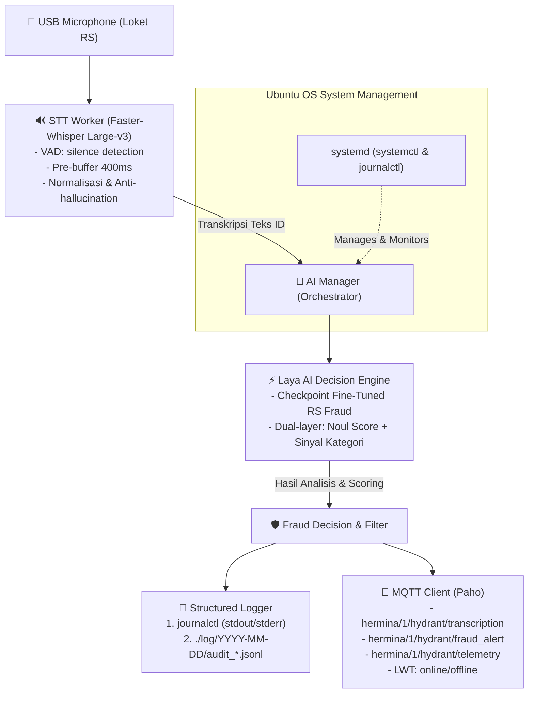

# 🏥 Laya AI — Realtime Voice Fraud Detection System (Headless Ubuntu Daemon)
## Master Plan & System Architecture

> **Project**: Realtime Voice Recognition & Fraud Detection for Hospital Receptionist  
> **Environment**: Ubuntu Server (Headless Daemon Service via `systemd`)  
> **Monitoring**: `journalctl` + Structured Daily File Log (`./log/YYYY-MM-DD/`)  
> **Telemetry & Dispatch**: **MQTT Protocol**  
> **Core AI Stack**: Faster-Whisper Large-v3 (Speech-to-Text) + Laya AI Decision Engine (Fine-Tuned RLCD)  
> **Target Deployment**: RS Hermina Receptionist Counter

---

## 1. Arsitektur Sistem & Alur Data

Sistem berjalan sebagai service latar belakang tanpa UI grafis. Audio ditangkap dari mikrofon loket resepsionis secara kontinu, diproses oleh Voice Activity Detection (VAD), ditranskripsi ke teks bahasa Indonesia dengan Whisper, lalu dianalisis intensinya oleh model Laya AI. Hasil deteksi dan event ditransmisikan secara realtime ke broker MQTT serta dicatat ke `journalctl` dan file log lokal.



---

## 2. MQTT Telemetry & Messaging Specification

### 2.1 Konfigurasi MQTT
Sesuai format konfigurasi target yang diintegrasikan ke `config/config.yaml`:
```yaml
MQTT:
  host: "192.168.100.2"
  port: 1883
  client_id: "hermina-fraud-receptionist-01"
  username: "nba"
  password: "137450"
  clean_session: true
  keep_alive: 60
  base_topic: "hermina/1/hydrant" # Root topic
  qos: 1  # AtLeastOnce
  retain: false
  use_tls: false
  tls_insecure: false
```

### 2.2 Skema Topic & Payload MQTT

| Topic Suffix | Fungsi | Frekuensi | Contoh Payload |
| :--- | :--- | :--- | :--- |
| `{base_topic}/status` | LWT (Last Will & Testament) | Connect / Disconnect | `{"status": "online", "uptime_ts": "..."}` |
| `{base_topic}/transcription` | Stream transkripsi kalimat | Tiap kalimat selesai | Lihat JSON 1 |
| `{base_topic}/fraud_alert` | Notifikasi deteksi fraud | Saat `is_fraud_score >= threshold` | Lihat JSON 2 |
| `{base_topic}/telemetry` | Health check & sensor audio | Tiap 10-30 detik | `{"device": "C270", "rms_volume": 0.04, "gpu_temp": 52}` |

#### JSON 1: Transcription Stream (`{base_topic}/transcription`)
```json
{
  "timestamp": "2026-11-18T11:45:10.235+07:00",
  "counter_id": "loket-01",
  "utterance_id": "utt_88492048",
  "text": "Untuk pembayaran administrasi silakan transfer ke rekening pribadi saya ya Bu",
  "speech_duration_sec": 3.42,
  "confidence": 0.96
}
```

#### JSON 2: Fraud Alert Payload (`{base_topic}/fraud_alert`)
```json
{
  "timestamp": "2026-11-18T11:45:10.450+07:00",
  "counter_id": "loket-01",
  "utterance_id": "utt_88492048",
  "transcript": "Untuk pembayaran administrasi silakan transfer ke rekening pribadi saya ya Bu",
  "fraud_score": 0.985,
  "level": "ESKALASI",
  "primary_category": "pembayaran_pribadi",
  "signals": {
    "minta_transfer": 0.98,
    "minta_data_sensitif": 0.05,
    "lewati_prosedur": 0.89,
    "desakan_waktu": 0.12,
    "mengaku_otoritas": 0.02
  },
  "action_recommendation": "Jangan transfer ke rekening pribadi. Seluruh pembayaran wajib melalui kasir/QRIS resmi.",
  "latency_ms": 215
}
```

---

## 3. Strategi Logging & Monitoring Service

Karena sistem berjalan tanpa antarmuka GUI, sistem logging dirancang 2 arah:

### 3.1 Console Logging untuk `journalctl`
- Diformat dengan prefix level log standar (`INFO`, `WARN`, `ERROR`, `CRIT`).
- Output bersih, tidak ada escape sequence yang merusak journalctl.
- Contoh output di terminal:
  ```
  2026-11-18 11:45:10 [INFO] [STT] Utterance detected (3.42s): "Untuk pembayaran administrasi..."
  2026-11-18 11:45:10 [ALERT] [FRAUD_DETECTED] Level=ESKALASI Score=0.985 Cat=pembayaran_pribadi
  2026-11-18 11:45:10 [INFO] [MQTT] Published alert to hermina/1/hydrant/fraud_alert (QoS 1)
  ```
- Command monitoring:
  ```bash
  # Pantau live logs
  journalctl -u hermina-fraud-detector.service -f
  
  # Pantau hanya peringatan fraud
  journalctl -u hermina-fraud-detector.service -f | grep ALERT
  ```

### 3.2 File Logging Terstruktur (`./log/YYYY-MM-DD/`)
- Directory dibuat otomatis per tanggal: `ai_fraud_detection_microphone/log/2026-11-18/`
- Dua jenis file:
  1. `transcripts_YYYYMMDD.jsonl`: Setiap ucapan dan teks hasil STT lengkap beserta timestamp untuk evaluasi dan retrain data sintetis.
  2. `fraud_incidents_YYYYMMDD.jsonl`: Audit trail lengkap saat ada flag risiko fraud.

---

## 4. Konfigurasi `systemd` (Daemon Service)

Service file: `/etc/systemd/system/hermina-fraud-detector.service`
```ini
[Unit]
Description=Hermina Receptionist Realtime AI Fraud Detection Service
After=network.target sound.target mosquitto.service
Wants=network.target

[Service]
Type=simple
User=ojan
Group=ojan
WorkingDirectory=/home/ojan/laya_ai/ai_fraud_detection_microphone
Environment="PATH=/home/ojan/laya_ai/.env_laya/bin:/usr/local/sbin:/usr/local/bin:/usr/sbin:/usr/bin"
Environment="PYTHONUNBUFFERED=1"
Environment="CUDA_VISIBLE_DEVICES=0"
ExecStart=/home/ojan/laya_ai/.env_laya/bin/python -m backend.app.main
Restart=on-failure
RestartSec=5s
StandardOutput=journal
StandardError=journal
SyslogIdentifier=hermina-fraud-ai

# Resource limits & Priority
LimitNOFILE=65535
Nice=-5

[Install]
WantedBy=multi-user.target
```

Manajemen service via command:
```bash
sudo systemctl daemon-reload
sudo systemctl enable hermina-fraud-detector.service
sudo systemctl start hermina-fraud-detector.service
sudo systemctl status hermina-fraud-detector.service
sudo journalctl -u hermina-fraud-detector.service -f -o cat
```

---

## 5. Model Laya AI & Dataset Tuning (Konteks RS Indonesia)

### 5.1 Dataset Generator v3 (`training/scripts/gen_fraud_dataset_v3.py`)
Meningkatkan dataset v2 dengan fokus:
1. **Kasus Penipuan Resepsionis RS**:
   - Pungutan liar pendaftaran / percepatan antrian poli.
   - Pengalihan transfer biaya kamar / operasi ke rekening/DANA/GoPay pribadi.
   - Penebusan obat langsung tanpa resep dan kasir apotek.
   - Permintaan kode OTP / PIN ATM / M-Banking pasien.
   - Manipulasi klaim BPJS atau surat rujukan palsu.
2. **Pasangan Minimal & Hard Negatives**:
   - Resepsionis mengingatkan pasien untuk **tidak** transfer ke rekening pribadi (Aman).
   - Resepsionis menyuruh memasukkan OTP sendiri di mesin antrian (Aman).
3. **Simulasi Noise STT (Whisper Realistis)**:
   - Tanpa tanda baca, huruf kecil semua.
   - Filler words Indonesia: `"eh"`, `"jadi"`, `"anu"`, `"begini mbak"`, `"sebentar pak"`.
   - Whisper artifact damping.

### 5.2 Training Pipeline & Metrik
- Base: `multilingual`
- Objective: RLCD, 8 epoch, micro-batch 8, grad-accum 2.
- 3-Seed Evaluation (s0, s1, s2) pada `heldout_v3.jsonl` dan `stress_test.jsonl`.
- Ambang batas (*threshold*):
  - `t_review`: 0.50 (Perlu Verifikasi)
  - `t_escalate`: 0.85 (Eskalasi Langsung)

---

## 6. Struktur Direktori Final Project

```
ai_fraud_detection_microphone/
├── backend/
│   ├── app/
│   │   ├── __init__.py
│   │   ├── main.py                     # Entry point daemon service
│   │   └── ai_manager.py              # Orchestrator audio -> STT -> Laya -> MQTT
│   ├── internal/
│   │   ├── ai_runtime/
│   │   │   ├── __init__.py
│   │   │   ├── background_process/
│   │   │   │   ├── __init__.py
│   │   │   │   ├── speech_to_text.py   # Async Whisper STT Worker + VAD
│   │   │   │   └── laya_ai_process.py  # Laya Inference Engine (noul + signals)
│   │   │   └── ai_fraud_detection.py   # Decision aggregation & classification
│   │   ├── client/
│   │   │   ├── __init__.py
│   │   │   └── mqtt_client.py         # Async Paho MQTT Client (Auto-reconnect)
│   │   └── utils/
│   │       ├── __init__.py
│   │       ├── audio.py                # Sounddevice helpers & normalization
│   │       ├── logger.py               # Journalctl-friendly stdout + JSONL logger
│   │       └── config_loader.py        # Yaml/JSON config parser
│   └── requirements.txt
├── config/
│   ├── config.yaml                     # MQTT, App, Model paths
│   └── microphone.json                 # Sample rate, device index, thresholds
├── systemd/
│   └── hermina-fraud-detector.service  # Service definition template
├── model/
│   └── laya-fraud-rs-best/             # Trained checkpoint Laya AI
├── log/                                # Auto-created per YYYY-MM-DD
├── scripts/
│   ├── run_standalone.sh               # Manual launch for testing
│   ├── install_service.sh              # Auto copy to /etc/systemd/system/
│   └── test_mqtt_sub.py                # Verification subscriber tool
└── training/
    ├── datasets/                       # train_v3, heldout_v3, stress_test
    ├── scripts/                        # gen_fraud_dataset_v3.py, train.sh
    └── evaluation/                     # eval_threshold.py, show_errors.py
```

---

## 7. Roadmap Eksekusi Step-by-Step

1. **Phase 1: Dataset & Model Tuning (Laya AI)**
   - Buat `gen_fraud_dataset_v3.py` dengan konteks resepsionis RS & noise ASR.
   - Generate dataset v3 (1200+ train, 400+ heldout, 80+ stress).
   - Training 3 seeds dengan `laya-train`.
   - Pilih checkpoint terbaik dan taruh di `model/laya-fraud-rs-best/`.

2. **Phase 2: Core Daemon Components**
   - Implementasi `config_loader.py` & `logger.py` (format journalctl + file JSONL).
   - Buat `mqtt_client.py` dengan auto-reconnect, buffer offline, dan publishing async.
   - Adaptasi `speech_to_text.py` dari `legacy/speech_to_text_microphone.py` ke worker modular.
   - Implementasi `laya_ai_process.py` dan `ai_fraud_detection.py`.

3. **Phase 3: Service Orchestration & Systemd**
   - Buat `ai_manager.py` yang mengikat STT queue, Laya inference, dan MQTT dispatch.
   - Buat `main.py` dengan graceful signal handler (`SIGTERM`, `SIGINT`).
   - Buat script instalasi service systemd dan uji coba dengan `systemctl` & `journalctl`.
   - Uji coba pengiriman payload ke broker MQTT target (`192.168.100.2:1883`).
